# Hiểu kiến trúc phân quyền cho chuỗi phòng khám — Phiên bản dễ hiểu

> **Dành cho:** lập trình viên mới hoặc ở mức middle, chưa từng thiết kế hệ thống phân quyền lớn.
>
> **Cách đọc:** đọc lần lượt từ Phần 1 đến Phần 7. Phần 7 (luồng dữ liệu) là phần quan trọng nhất. Gặp thuật ngữ lạ thì tra ở **Phần 11 – Bảng thuật ngữ**. Phần 13 mở rộng kiến trúc theo framework OpenHIE; nên đọc sau khi đã nắm Phần 1–8.
>
> **Cách xem sơ đồ:** tài liệu dùng sơ đồ Mermaid. Sơ đồ hiển thị tự động khi mở bằng GitHub, GitLab, Obsidian, Typora, hoặc VS Code (cài extension *Markdown Preview Mermaid Support*). Nếu mở bằng trình xem không hỗ trợ, bạn sẽ thấy mã nguồn sơ đồ; có thể dán vào https://mermaid.live để xem.

---

## Mục lục

1. Ý tưởng cốt lõi trong 1 phút
2. Hệ thống được tổ chức như thế nào
3. Các nhân vật dùng làm ví dụ xuyên suốt
4. Ba viên gạch nền móng: Permission, Role, Role Assignment
5. Phạm vi (Scope) và kế thừa quyền
6. Hai lớp quyền: "Bạn là ai" và "Bạn đang làm gì"
7. **Luồng dữ liệu — từng bước một**
8. Ba lớp bảo vệ
9. Cache — vì sao cần và dùng thế nào
10. Một ngày làm việc: tổng hợp các tình huống
11. Bảng thuật ngữ
12. Câu hỏi thường gặp
13. **Mở rộng theo OpenHIE — khi hệ thống cần "nói chuyện" với hệ thống khác** *(mới)*
14. Gợi ý thứ tự triển khai

---

## Phần 1. Ý tưởng cốt lõi trong 1 phút

Hãy tưởng tượng hệ thống phần mềm là **một tòa nhà phòng khám**.

Khi bạn bước vào, có hai việc hoàn toàn khác nhau xảy ra:

| Câu hỏi | Ví dụ ngoài đời | Tên kỹ thuật | Ai làm |
|---|---|---|---|
| **Bạn là ai?** | Bảo vệ kiểm tra thẻ nhân viên ở cổng | **Authentication** (xác thực, viết tắt AuthN) | Hệ thống đăng nhập |
| **Bạn được làm gì?** | Thẻ của bạn mở được những cánh cửa nào | **Authorization** (phân quyền, viết tắt AuthZ) | Hệ thống phân quyền |

Tài liệu này chủ yếu nói về câu hỏi thứ hai: **phân quyền**.

Toàn bộ kiến trúc có thể tóm gọn trong một câu:

> **Mỗi khi ai đó muốn làm gì, hệ thống hỏi: "Người này có được làm việc này, với dữ liệu này, ở nơi này, vào lúc này không?" — và câu trả lời phải đến từ một nơi duy nhất, nhất quán.**

Bốn chữ "việc này", "dữ liệu này", "nơi này", "lúc này" chính là bốn thứ mà các phần sau sẽ giải thích.

---

## Phần 2. Hệ thống được tổ chức như thế nào

### 2.1 Ví dụ: Chuỗi Phòng khám An Tâm

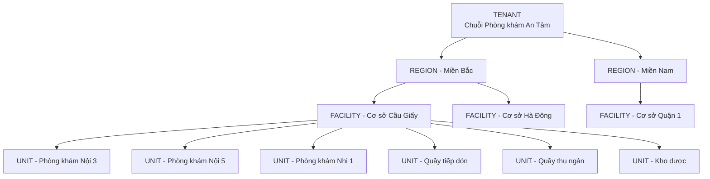

### 2.2 Giải thích từng cấp

| Cấp | Tên trong code | Nghĩa đời thường | Ví dụ |
|---|---|---|---|
| **Tenant** | `Tenant` | "Khách hàng" sử dụng phần mềm, thường là một công ty/thương hiệu. Dữ liệu giữa hai tenant **tuyệt đối không được nhìn thấy nhau**. | Chuỗi Phòng khám An Tâm |
| **Region** *(không bắt buộc)* | `Region` | Vùng/cụm, dùng khi có người quản lý nhiều cơ sở cùng lúc | Miền Bắc |
| **Facility** | `Facility` | **Cơ sở vật lý**: có địa chỉ, có giấy phép, có nhân viên | Cơ sở Cầu Giấy |
| **Unit** | `Unit` | **Đơn vị bên trong cơ sở**: phòng khám chuyên khoa, quầy, kho, phòng xét nghiệm | Phòng khám Nội 3, Kho dược |

### 2.3 Hai lưu ý quan trọng về tên gọi

**Lưu ý 1 — Tránh chữ "phòng khám" mơ hồ.** Trong tiếng Việt, "phòng khám" vừa là cả cơ sở ("Phòng khám Đa khoa X") vừa là một phòng bên trong ("Phòng khám Nội số 3"). Trong code, ta dùng `Facility` cho cơ sở và `Unit` cho phòng, để không ai hiểu nhầm.

**Lưu ý 2 — Vì sao gộp mọi loại phòng vào "Unit"?** Phòng khám, quầy tiếp đón, kho dược, phòng xét nghiệm đều là "một chỗ bên trong cơ sở có người làm việc". Gộp chung thành `Unit` và phân biệt bằng cột `unit_type` giúp:

- thêm loại phòng mới (ví dụ phòng vật lý trị liệu) chỉ cần thêm một giá trị `unit_type`, không cần thêm bảng mới;
- logic phân quyền chỉ phải xử lý một khái niệm.

```text
units
┌──────┬─────────────┬──────────────┬───────────┬────────────────────┐
│ id   │ facility_id │ unit_type    │ specialty │ name               │
├──────┼─────────────┼──────────────┼───────────┼────────────────────┤
│ U1   │ F1          │ exam_room    │ noi       │ Phòng khám Nội 3   │
│ U2   │ F1          │ exam_room    │ noi       │ Phòng khám Nội 5   │
│ U4   │ F1          │ reception    │ -         │ Quầy tiếp đón      │
│ U6   │ F1          │ pharmacy     │ -         │ Kho dược           │
└──────┴─────────────┴──────────────┴───────────┴────────────────────┘
```

### 2.4 Dữ liệu nằm ở cấp nào?

Đây là điểm người mới hay nhầm. **Không phải mọi dữ liệu đều thuộc về một cơ sở.**

| Dữ liệu | Thuộc cấp | Lý do |
|---|---|---|
| Bệnh nhân (`patients`) | **Tenant** | Bà Mai khám ở Cầu Giấy hôm nay, tháng sau tái khám ở Hà Đông — vẫn là một hồ sơ |
| Lượt khám (`encounters`) | **Facility** | Mỗi lượt khám diễn ra ở một cơ sở cụ thể |
| Lịch hẹn, hóa đơn | **Facility** | Gắn với nơi cung cấp dịch vụ |
| Hàng đợi khám (`queue_entries`) | **Unit** | Bệnh nhân xếp hàng chờ một phòng cụ thể |
| Tồn kho thuốc | **Unit** (kho) | Mỗi kho có số lượng riêng |

---

## Phần 3. Các nhân vật dùng làm ví dụ xuyên suốt

Toàn bộ tài liệu sẽ dùng những người này. Hãy nhớ tên họ.

| Nhân vật | Công việc | Làm việc ở |
|---|---|---|
| **BS Minh** | Bác sĩ nội khoa | Cơ sở Cầu Giấy, xoay giữa phòng Nội 3 và Nội 5 theo lịch |
| **Y tá Lan** | Điều dưỡng | Cơ sở Cầu Giấy, xoay phòng theo lịch |
| **Hộ lý Hùng** | Hộ lý, hỗ trợ di chuyển bệnh nhân | Cơ sở Cầu Giấy |
| **Chị Hoa** | Nhân viên tiếp đón | Quầy tiếp đón, Cơ sở Cầu Giấy |
| **Anh Tú** | Dược sĩ cấp phát | Kho dược, Cơ sở Cầu Giấy |
| **Anh Nam** | Quản lý cơ sở | Cơ sở Cầu Giấy |
| **Chị Thu** | Quản lý vùng | Toàn bộ Miền Bắc |
| **Bà Mai** | Bệnh nhân | Đang chờ khám ở phòng Nội 3 |

---

## Phần 4. Ba viên gạch nền móng: Permission, Role, Role Assignment

### 4.1 So sánh với chùm chìa khóa

| Khái niệm | So sánh đời thường | Ví dụ |
|---|---|---|
| **Permission** (quyền) | **Một chiếc chìa khóa** mở đúng một loại cửa | `patient.clinical.read` = chìa mở "xem hồ sơ bệnh án" |
| **Role** (vai trò) | **Một chùm chìa khóa** đã được gom sẵn | Role "Bác sĩ" = chùm gồm chìa xem bệnh án, chìa kê đơn, chìa chỉ định xét nghiệm |
| **Role Assignment** (giao vai trò) | **Giao chùm chìa cho ai, dùng ở tòa nhà nào** | Giao chùm "Bác sĩ" cho BS Minh, dùng ở Cơ sở Cầu Giấy |

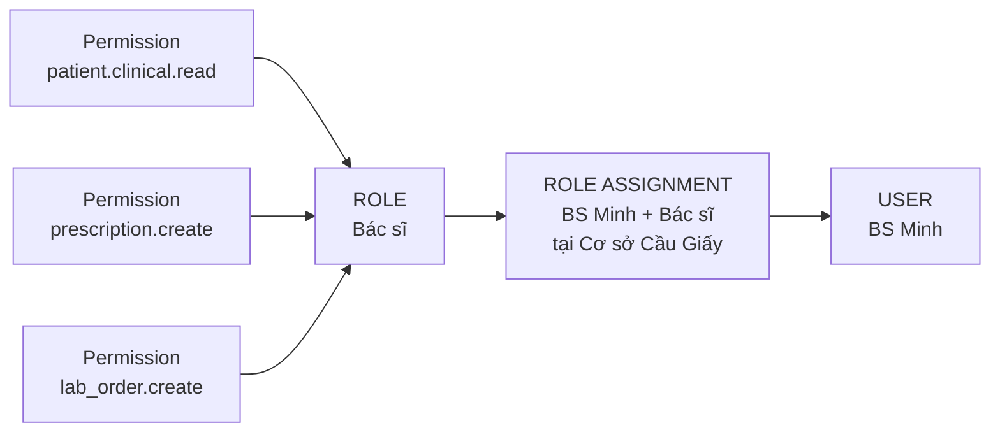

### 4.2 Cách đặt tên permission

Quy ước: `tài_nguyên.hành_động` (có thể thêm cấp giữa).

| Permission | Nghĩa |
|---|---|
| `patient.demographics.read` | Xem thông tin hành chính bệnh nhân (tên, SĐT, địa chỉ) |
| `patient.clinical.read` | Xem thông tin lâm sàng (chẩn đoán, kết quả) |
| `patient.sensitive.read` | Xem dữ liệu nhạy cảm (HIV, tâm thần...) |
| `queue.view` | Xem hàng đợi khám |
| `prescription.create` | Kê đơn thuốc |
| `prescription.dispense` | Cấp phát thuốc theo đơn |
| `inventory.adjust` | Điều chỉnh tồn kho |
| `inventory.adjust.approve` | Duyệt phiếu điều chỉnh tồn kho |
| `invoice.create` | Tạo hóa đơn |

### 4.3 Ai sở hữu cái gì

| Thành phần | Ai tạo/sửa | Sửa có phải deploy code không? |
|---|---|---|
| Permission | **Lập trình viên**, viết trong code | Có — vì permission mới = tính năng mới |
| Role | **Admin**, qua màn hình quản trị | Không |
| Role Assignment | **Admin**, qua màn hình quản trị | Không |

### 4.4 Quy tắc vàng: code chỉ hỏi PERMISSION, không bao giờ hỏi tên ROLE

**Cách làm sai:**

```csharp
// ❌ SAI: code biết tên role
if (user.Role == "Doctor" || user.Role == "Nurse")
{
    return patient.Diagnosis;
}
```

Vấn đề: ngày mai admin tạo role mới "Bác sĩ thực tập". Code trên không biết role này tồn tại → bác sĩ thực tập bị chặn → phải sửa code, deploy lại.

**Cách làm đúng:**

```csharp
// ✅ ĐÚNG: code chỉ hỏi "có chìa khóa này không"
if (await authz.HasPermission(user, "patient.clinical.read", patient))
{
    return patient.Diagnosis;
}
```

Admin tạo role "Bác sĩ thực tập", tick chọn `patient.clinical.read` → code tự hoạt động đúng, **không cần sửa một dòng nào**.

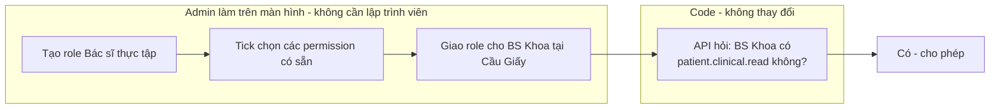

---

## Phần 5. Phạm vi (Scope) và kế thừa quyền

### 5.1 Scope là gì?

**Scope = "chùm chìa khóa này dùng được ở đâu"**. Cùng là role "Quản lý", nhưng:

- Anh Nam là Quản lý **ở Cơ sở Cầu Giấy** → chỉ quản lý Cầu Giấy.
- Chị Thu là Quản lý **ở Miền Bắc** → quản lý mọi cơ sở thuộc Miền Bắc.

### 5.2 Kế thừa: gán ở trên, tự có quyền ở dưới

Khi gán quyền ở một cấp, người đó **tự động có quyền ở mọi cấp con**. Giống như chìa khóa tổng của tòa nhà mở được mọi phòng trong tòa nhà.

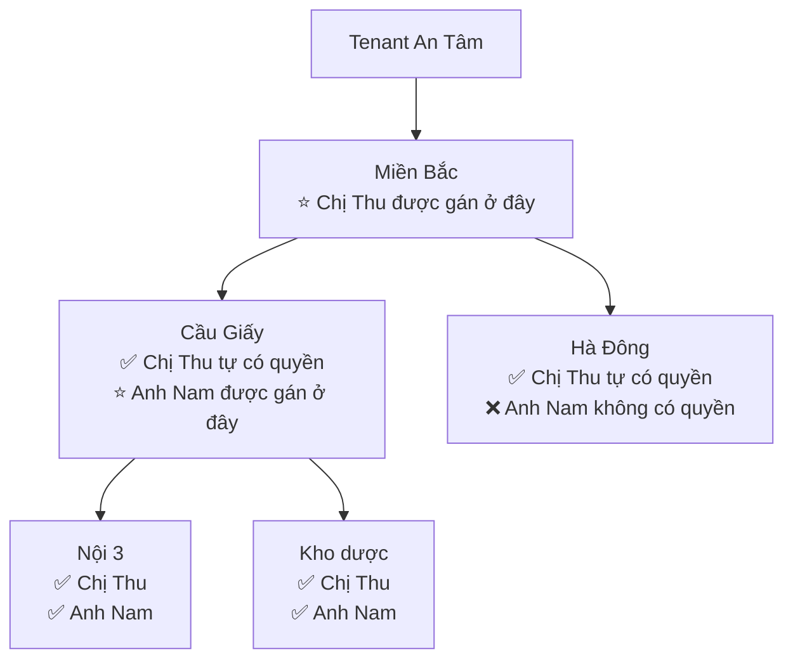

**Lợi ích:** Chị Thu quản lý 50 cơ sở, nhưng chỉ cần **1 dòng** gán quyền thay vì 50 dòng. Khi mở cơ sở thứ 51 ở Miền Bắc, chị Thu tự động có quyền, không ai phải làm gì.

### 5.3 Bảng `role_assignments` trông như thế nào

```text
role_assignments
┌───────────┬──────────────┬────────────┬──────────────┬─────────────┐
│ user      │ role         │ scope_type │ scope        │ valid_to    │
├───────────┼──────────────┼────────────┼──────────────┼─────────────┤
│ BS Minh   │ Bác sĩ       │ facility   │ Cầu Giấy     │ (không hạn) │
│ Y tá Lan  │ Điều dưỡng   │ facility   │ Cầu Giấy     │ (không hạn) │
│ Hộ lý Hùng│ Hộ lý        │ facility   │ Cầu Giấy     │ (không hạn) │
│ Chị Hoa   │ Tiếp đón     │ unit       │ Quầy tiếp đón│ (không hạn) │
│ Anh Tú    │ Dược sĩ      │ unit       │ Kho dược     │ (không hạn) │
│ Anh Nam   │ Quản lý      │ facility   │ Cầu Giấy     │ (không hạn) │
│ Chị Thu   │ Quản lý vùng │ region     │ Miền Bắc     │ (không hạn) │
│ BS Khoa   │ BS thực tập  │ facility   │ Cầu Giấy     │ 31/12/2026  │
└───────────┴──────────────┴────────────┴──────────────┴─────────────┘
```

Cột `valid_to` cho phép quyền **tự hết hạn**: BS Khoa thực tập đến hết năm, sau đó tự mất quyền mà không ai cần nhớ đi thu hồi.

---

## Phần 6. Hai lớp quyền: "Bạn là ai" và "Bạn đang làm gì"

### 6.1 Vấn đề

BS Minh có role Bác sĩ ở Cầu Giấy. Câu hỏi: **BS Minh có được xem bệnh án của MỌI bệnh nhân đang chờ ở Cầu Giấy không?**

Không nên. Cơ sở Cầu Giấy có 15 phòng khám. BS Minh chỉ nên thấy bệnh nhân **của phòng mình đang ngồi**. Nhưng BS Minh lại **đổi phòng theo lịch**:

| Thời gian | BS Minh ngồi ở |
|---|---|
| Thứ Hai, 7h–11h30 | Phòng Nội 3 |
| Thứ Hai, 13h–17h | Phòng Nội 5 |
| Thứ Ba | Nghỉ |

Nếu mỗi lần đổi phòng lại phải admin vào sửa role thì 1.000 cơ sở × hàng chục bác sĩ × 2 ca/ngày = **hàng chục nghìn lần sửa quyền mỗi ngày**. Không khả thi.

### 6.2 Giải pháp: tách làm hai lớp

| | **Lớp 1 — Năng lực** | **Lớp 2 — Ngữ cảnh vận hành** |
|---|---|---|
| Trả lời câu hỏi | "Bạn là ai, làm nghề gì, ở cơ sở nào?" | "Lúc này bạn đang làm gì, với bệnh nhân nào?" |
| Ví dụ | BS Minh là Bác sĩ ở Cầu Giấy | BS Minh đang trực phòng Nội 3, ca sáng thứ Hai |
| Thay đổi | Hiếm (khi tuyển dụng, chuyển công tác, nghỉ việc) | Liên tục (mỗi ca) |
| Ai nhập | Admin / nhân sự | Bộ phận điều phối xếp lịch (việc họ vốn đã làm) |
| Lưu ở bảng | `role_assignments` | `duty_rosters` (lịch trực), `encounters` (lượt khám) |

**Quyết định cuối cùng = Lớp 1 VÀ Lớp 2 đều đồng ý.**

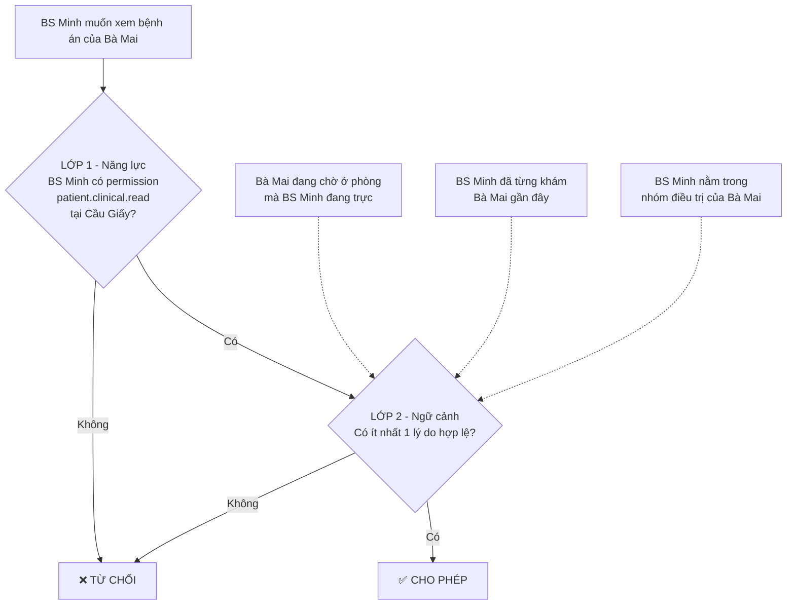

### 6.3 Kết quả theo thời gian

Bà Mai đang chờ ở phòng **Nội 3**.

| Lúc | BS Minh đang trực | Lớp 1 | Lớp 2 | Kết quả |
|---|---|---|---|---|
| Thứ Hai 9h00 | Nội 3 | ✅ | ✅ Bà Mai chờ ở Nội 3 | **Cho phép** |
| Thứ Hai 14h00 | Nội 5 | ✅ | ❌ Bà Mai không ở Nội 5 | **Từ chối** |
| Thứ Hai 14h00, nhưng BS Minh đã khám Bà Mai lúc sáng | Nội 5 | ✅ | ✅ Đã khám gần đây | **Cho phép** (để xem lại kết quả xét nghiệm) |
| Thứ Ba | Nghỉ | ✅ | ❌ | **Từ chối** |

Không ai phải sửa quyền. **Lịch thay đổi thì quyền tự thay đổi theo.**

### 6.4 Bảng lịch trực

```text
duty_rosters
┌───────────┬──────────┬───────────────────┬──────────────────┐
│ user      │ unit     │ shift_start       │ shift_end        │
├───────────┼──────────┼───────────────────┼──────────────────┤
│ BS Minh   │ Nội 3    │ 09/11/2026 07:00  │ 09/11/2026 11:30 │
│ BS Minh   │ Nội 5    │ 09/11/2026 13:00  │ 09/11/2026 17:00 │
│ Y tá Lan  │ Nội 3    │ 09/11/2026 07:00  │ 09/11/2026 17:00 │
│ Hộ lý Hùng│ Nội 3    │ 09/11/2026 07:00  │ 09/11/2026 11:30 │
└───────────┴──────────┴───────────────────┴──────────────────┘
```

### 6.5 Ai dùng lớp nào?

| Vai trò | Lớp 1 (role) | Lớp 2 (lịch/lượt khám) | Vì sao |
|---|---|---|---|
| Bác sĩ, Y tá, Hộ lý | ✅ | ✅ | Xoay phòng theo ca |
| Tiếp đón, Thu ngân, Dược sĩ, Thủ kho | ✅ | ❌ không cần | Ngồi cố định một chỗ, gán role thẳng vào Unit là đủ |
| Quản lý cơ sở, Quản lý vùng | ✅ | ❌ không cần | Xem báo cáo tổng hợp; xem bệnh án chỉ qua "truy cập khẩn cấp" |

---

## Phần 7. Luồng dữ liệu — từng bước một

Đây là phần quan trọng nhất. Mỗi luồng gồm: **tình huống → sơ đồ → giải thích từng bước**.

### 7.1 Bản đồ tổng thể: các thành phần trong hệ thống

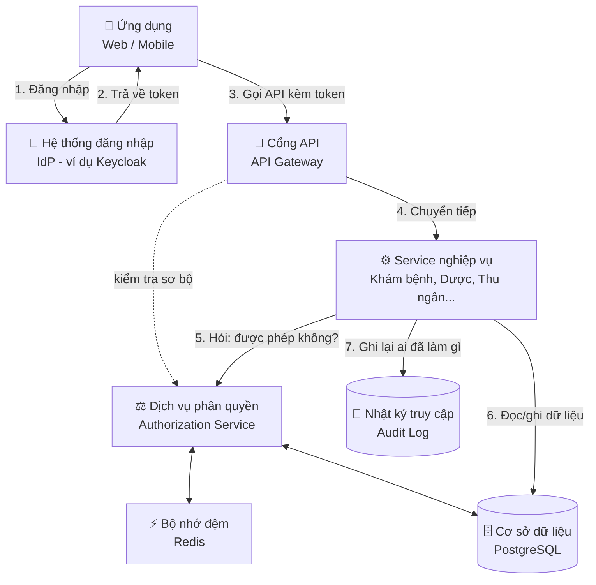

| Thành phần | Vai trò đời thường | Nhiệm vụ |
|---|---|---|
| **Hệ thống đăng nhập (IdP)** | Phòng cấp thẻ nhân viên | Kiểm tra mật khẩu, mã OTP; cấp "thẻ" (token) chứng minh bạn là ai |
| **Cổng API (Gateway)** | Bảo vệ ở cổng tòa nhà | Kiểm tra thẻ có hợp lệ không, chặn sơ bộ các yêu cầu rõ ràng không được phép |
| **Service nghiệp vụ** | Nhân viên các phòng ban | Xử lý công việc thật: khám bệnh, kê đơn, thu tiền |
| **Dịch vụ phân quyền** | Phòng pháp chế — nơi duy nhất ra quyết định "được hay không" | Nhận câu hỏi, tra quy định, trả lời CÓ/KHÔNG |
| **Bộ nhớ đệm (Redis)** | Sổ tay ghi nhớ | Lưu tạm câu trả lời để không phải tra lại từ đầu mỗi lần |
| **Cơ sở dữ liệu** | Kho lưu trữ hồ sơ | Lưu mọi dữ liệu; tự chặn nếu ai đó cố đọc dữ liệu tenant khác |
| **Nhật ký truy cập** | Sổ ghi chép ra vào | Ghi lại mọi lượt xem/sửa dữ liệu bệnh nhân |

> 🔗 Phiên bản mở rộng của bản đồ này, có thêm hệ thống bên ngoài, danh bạ gốc và bộ mã chuẩn theo OpenHIE, nằm ở **Phần 13.9**.

> 💡 **Điều quan trọng nhất:** các service nghiệp vụ **không tự quyết định** quyền. Chúng luôn **hỏi** Dịch vụ phân quyền. Nhờ vậy, quy tắc chỉ viết ở một chỗ, không bị mỗi service hiểu một kiểu.

---

### 7.2 Luồng đăng nhập

**Tình huống:** BS Minh mở ứng dụng lúc 6h55 sáng thứ Hai.

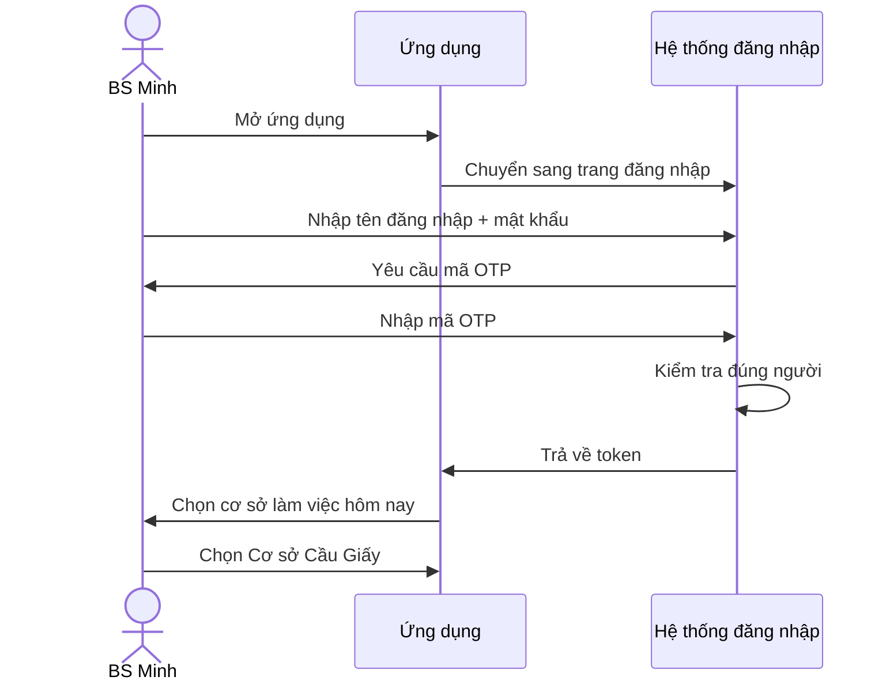

**Token trông như thế nào?** Token là một chuỗi mã hóa. Khi giải mã, bên trong chứa:

```json
{
  "sub": "user-bs-minh",
  "tid": "tenant-an-tam",
  "active_facility": "facility-cau-giay",
  "exp": 1762736100
}
```

| Trường | Nghĩa |
|---|---|
| `sub` | Mã định danh người dùng (BS Minh) |
| `tid` | Thuộc tenant nào (Chuỗi An Tâm) |
| `active_facility` | Đang làm việc ở cơ sở nào |
| `exp` | Thời điểm token hết hạn (thường 15–30 phút, sau đó tự làm mới) |

> ⚠️ **Vì sao token KHÔNG chứa danh sách quyền?**
>
> 1. **Thu hồi không kịp:** nếu quyền nằm trong token, khi admin thu hồi quyền của ai đó, token cũ vẫn mang quyền cũ cho đến khi hết hạn.
> 2. **Token quá to:** Chị Thu có quyền ở 50 cơ sở, mỗi cơ sở hàng chục quyền → token phình to, mỗi request đều phải gửi đi.
> 3. **Lớp 2 (lịch trực) thay đổi theo giờ** — không thể đóng gói sẵn vào token.
>
> → Token chỉ nói "**bạn là ai**". Còn "**bạn được làm gì**" thì hỏi Dịch vụ phân quyền mỗi lần.

---

### 7.3 Luồng kiểm tra quyền cho một yêu cầu

**Tình huống:** 9h00 thứ Hai, BS Minh (đang trực Nội 3) bấm vào hồ sơ của Bà Mai (đang chờ ở Nội 3).

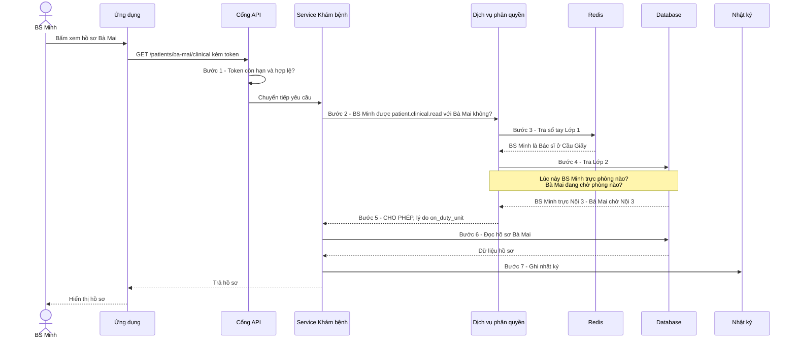

**Giải thích từng bước:**

| Bước | Việc gì xảy ra | Nếu thất bại thì sao |
|---|---|---|
| 1 | Cổng API kiểm tra token: còn hạn không, có bị làm giả không | Trả lỗi `401 Unauthorized` — "bạn chưa đăng nhập" |
| 2 | Service khám bệnh **không tự quyết**, mà gửi câu hỏi cho Dịch vụ phân quyền | — |
| 3 | Tra Lớp 1 (role, permission) trong Redis cho nhanh. Nếu Redis chưa có, tra database rồi lưu vào Redis | Không có permission → từ chối ngay |
| 4 | Tra Lớp 2: lịch trực hiện tại và hàng đợi | Không có lý do hợp lệ → từ chối |
| 5 | Trả quyết định **kèm lý do** (để ghi nhật ký) | Trả lỗi `403 Forbidden` — "bạn không có quyền" |
| 6 | Đọc dữ liệu. Database **tự kiểm tra thêm một lần nữa** rằng dữ liệu thuộc đúng tenant (xem Phần 8) | Database trả về rỗng |
| 7 | Ghi lại: ai, xem gì, của bệnh nhân nào, lúc nào, vì lý do gì | — |

**Mã giả cho Bước 2 ở service:**

```csharp
[HttpGet("patients/{id}/clinical")]
public async Task<IActionResult> GetClinical(Guid id)
{
    var result = await authz.Check(
        user:       CurrentUser,
        permission: "patient.clinical.read",
        resource:   $"patient:{id}");

    if (!result.Allowed)
        return Forbid();                 // 403

    var record = await db.GetClinicalRecord(id);
    await audit.Log(CurrentUser, "patient.clinical.read", id, result.Reason);
    return Ok(record);
}
```

---

### 7.4 Luồng xem danh sách (hàng đợi khám)

**Tình huống:** 9h00, BS Minh mở màn hình "Bệnh nhân chờ khám".

**Vấn đề:** Cơ sở Cầu Giấy có 300 bệnh nhân đang chờ ở 15 phòng. Nếu lấy cả 300 người ra rồi hỏi Dịch vụ phân quyền 300 lần ("người này được xem không?") thì **rất chậm**.

**Giải pháp: đảo ngược câu hỏi.**

| ❌ Cách chậm | ✅ Cách nhanh |
|---|---|
| Lấy 300 bệnh nhân, hỏi từng người: "BS Minh được xem người này không?" | Hỏi **một lần**: "Lúc này BS Minh được xem bệnh nhân của những phòng nào?" → "Nội 3". Rồi chỉ lấy bệnh nhân phòng Nội 3. |

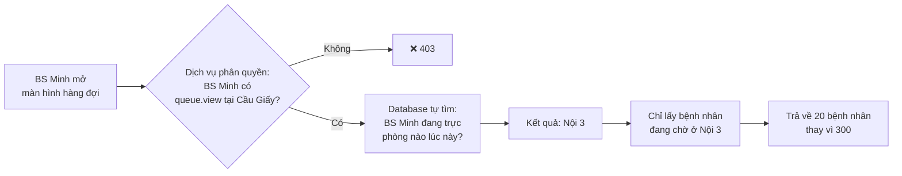

**Câu SQL (đã đơn giản hóa):**

```sql
SELECT q.ticket_no, p.full_name, q.arrived_at
FROM   queue_entries q
JOIN   duty_rosters  r ON r.unit_id = q.unit_id      -- nối hàng đợi với lịch trực
JOIN   patients      p ON p.id      = q.patient_id
WHERE  r.user_id = 'user-bs-minh'                    -- lịch trực của BS Minh
  AND  now() BETWEEN r.shift_start AND r.shift_end   -- đúng ca hiện tại
  AND  q.status = 'waiting'
ORDER  BY q.ticket_no;
```

Đọc câu SQL theo tiếng Việt: *"Lấy các bệnh nhân đang chờ, ở những phòng mà BS Minh có lịch trực vào đúng lúc này, sắp xếp theo số thứ tự."*

**Kết quả cùng một màn hình, khác người xem:**

| Người mở màn hình | Thấy gì |
|---|---|
| BS Minh, 9h00 | 20 bệnh nhân chờ ở Nội 3 |
| BS Minh, 14h00 | Bệnh nhân chờ ở Nội 5 |
| Y tá Lan, 9h00 | Bệnh nhân chờ ở Nội 3 (cũng trực Nội 3) |
| Anh Nam (quản lý) | Tổng số chờ ở từng phòng — không thấy tên bệnh nhân |

---

### 7.5 Luồng che bớt dữ liệu: cùng hồ sơ, mỗi người thấy một phần

**Tình huống:** Bà Mai có chẩn đoán "Viêm dạ dày" và một ghi chú nhạy cảm. Ba người cùng mở hồ sơ của Bà Mai.

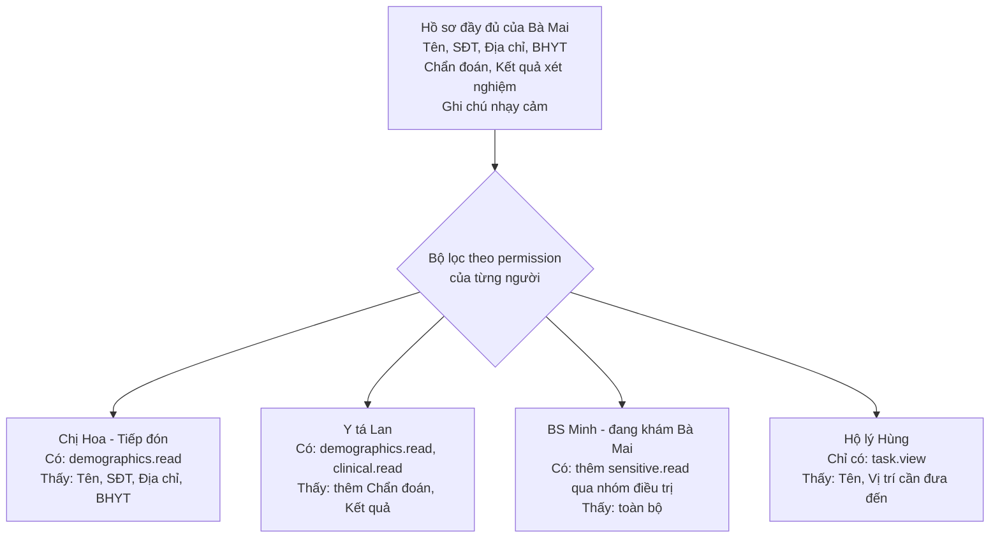

**Mã giả:**

```csharp
var perms = await authz.GetPermissions(CurrentUser, patient);

var dto = new PatientView
{
    Name      = patient.Name,
    Phone     = perms.Has("patient.demographics.read") ? patient.Phone     : null,
    Diagnosis = perms.Has("patient.clinical.read")     ? patient.Diagnosis : null,
    Sensitive = perms.Has("patient.sensitive.read")    ? patient.Sensitive : null,
};
```

Màn hình chỉ hiển thị những trường không bị `null`.

---

### 7.6 Luồng admin thay đổi quyền

**Tình huống:** Anh Nam (quản lý) muốn Y tá Lan được phép **cấp phát thuốc** tạm thời trong 1 tuần vì Anh Tú (dược sĩ) nghỉ phép.

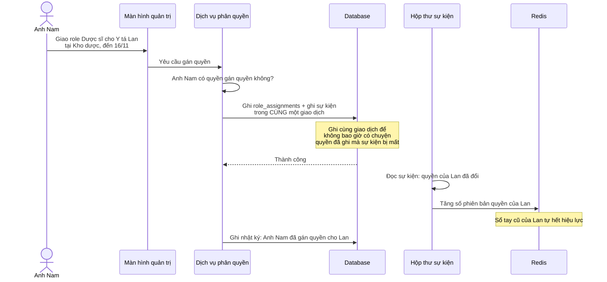

**Sau đó:**

- Lần tiếp theo Y tá Lan mở màn hình kho → Dịch vụ phân quyền thấy phiên bản đã đổi → tra lại database → thấy quyền mới → **cho phép**.
- Ngày 16/11 → `valid_to` hết hạn → quyền **tự biến mất**. Anh Nam không cần nhớ thu hồi.

> 💡 **"Hộp thư sự kiện" (Outbox) là gì?** Là một bảng trong database, nơi ghi lại "vừa có thay đổi gì". Một tiến trình chạy nền đọc bảng này và thông báo cho các nơi cần biết (ví dụ: xóa sổ tay cũ trong Redis). Vì được ghi cùng lúc với thay đổi quyền, nó đảm bảo **không có thay đổi nào bị bỏ sót**.

---

### 7.7 Luồng thu hồi quyền khi nhân viên nghỉ việc

**Tình huống:** 10h00, Hộ lý Hùng bị cho nghỉ việc ngay lập tức. Lúc đó Hùng vẫn đang đăng nhập trên điện thoại.

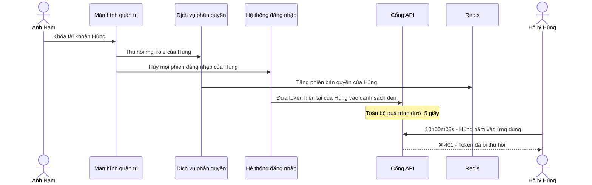

Có **ba lớp** cùng chặn cùng lúc: hủy phiên đăng nhập, đưa token vào danh sách đen, và xóa quyền. Kể cả nếu một lớp có trục trặc, hai lớp còn lại vẫn chặn được.

---

### 7.8 Luồng truy cập khẩn cấp (Break-glass)

**Tình huống:** 15h00, một bệnh nhân ngất tại hành lang. BS Minh chạy đến. Bệnh nhân này không nằm trong hàng đợi của phòng BS Minh, nên bình thường BS Minh **không được** xem bệnh án. Nhưng cần biết ngay bệnh nhân có dị ứng thuốc không.

Tên "break-glass" lấy từ hình ảnh **đập kính lấy bình chữa cháy**: ai cũng được làm khi khẩn cấp, nhưng ai làm cũng bị ghi lại và phải giải trình.

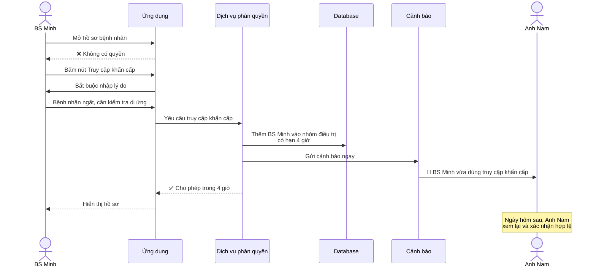

---

### 7.9 Luồng ghi nhật ký truy cập

Mọi lượt **xem** và **sửa** dữ liệu bệnh nhân đều được ghi lại. Không chỉ ghi khi sửa, mà cả khi chỉ xem.

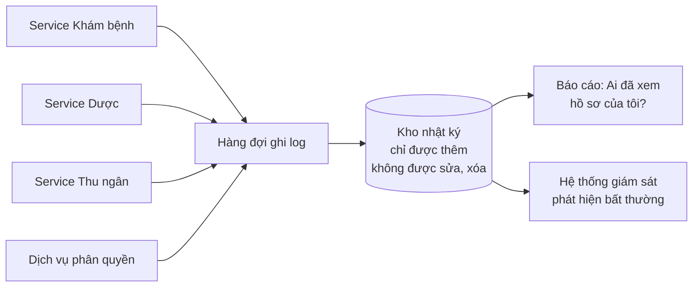

**Một dòng nhật ký trông như thế nào:**

```json
{
  "time": "2026-11-09T09:00:12+07:00",
  "user": "user-bs-minh",
  "action": "patient.clinical.read",
  "patient": "patient-ba-mai",
  "facility": "facility-cau-giay",
  "decision": "allow",
  "reason": "on_duty_unit:noi-3",
  "ip": "10.2.15.33"
}
```

**Ví dụ phát hiện bất thường:** một nhân viên tiếp đón xem 500 hồ sơ trong 10 phút lúc 23h → hệ thống giám sát tự gửi cảnh báo.

---

## Phần 8. Ba lớp bảo vệ

### 8.1 So sánh với tòa nhà

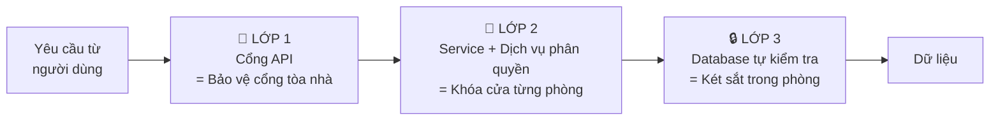

| Lớp | Kiểm tra gì | Ví dụ chặn được |
|---|---|---|
| 1. Cổng API | Token hợp lệ? Có quyền gì đó ở cơ sở này không? | Người đã nghỉ việc, token giả |
| 2. Service | Được làm đúng việc này với đúng bệnh nhân này không? | BS Minh xem bệnh nhân phòng khác |
| 3. Database | Dữ liệu này có thuộc đúng tenant/cơ sở không? | Lập trình viên viết code bị lỗi |

### 8.2 Vì sao cần lớp 3 khi đã có lớp 2?

Vì **con người viết code thì có lúc quên**. Hãy xem ví dụ:

```csharp
// Lập trình viên A viết đúng:
db.Invoices.Where(i => i.TenantId == currentTenant && i.Status == "paid");

// Lập trình viên B, 6 tháng sau, viết báo cáo mới và QUÊN điều kiện tenant:
db.Invoices.Where(i => i.Status == "paid");
// → Nếu không có lớp 3: trả về hóa đơn của TẤT CẢ các chuỗi phòng khám!
```

**Lớp 3 dùng tính năng Row-Level Security (RLS) của PostgreSQL.** Hiểu đơn giản: ta dặn database một lần *"mỗi khi ai đọc bảng hóa đơn, tự động chỉ trả về dòng của tenant hiện tại"*. Từ đó, dù code có quên điều kiện, database vẫn tự thêm vào.

```sql
-- Dặn database MỘT LẦN khi tạo bảng
ALTER TABLE invoices ENABLE ROW LEVEL SECURITY;

CREATE POLICY chi_xem_tenant_cua_minh ON invoices
  USING (tenant_id = current_setting('app.tenant_id')::uuid);
```

```csharp
// Mỗi request, service đặt "tenant hiện tại" một lần ở đầu
await db.Execute("SET LOCAL app.tenant_id = @t", currentTenant);

// Sau đó, dù lập trình viên B quên điều kiện:
db.Invoices.Where(i => i.Status == "paid");
// → Database TỰ ĐỘNG chỉ trả hóa đơn của tenant hiện tại ✅
```

---

## Phần 9. Cache — vì sao cần và dùng thế nào

### 9.1 Vì sao cần?

Mỗi lần bấm nút đều phải hỏi quyền. Hệ thống 1 triệu người dùng có thể có **hàng nghìn câu hỏi mỗi giây**. Nếu lần nào cũng tra database thì database quá tải.

**Cache (Redis) giống một cuốn sổ tay:** lần đầu tra database, ghi kết quả vào sổ tay. Lần sau tra sổ tay, nhanh hơn khoảng 50–100 lần.

### 9.2 Vấn đề: sổ tay bị cũ

Nếu Anh Nam vừa thu hồi quyền của ai đó, mà sổ tay vẫn ghi "có quyền" thì sao? **Giải pháp: đánh số phiên bản.**

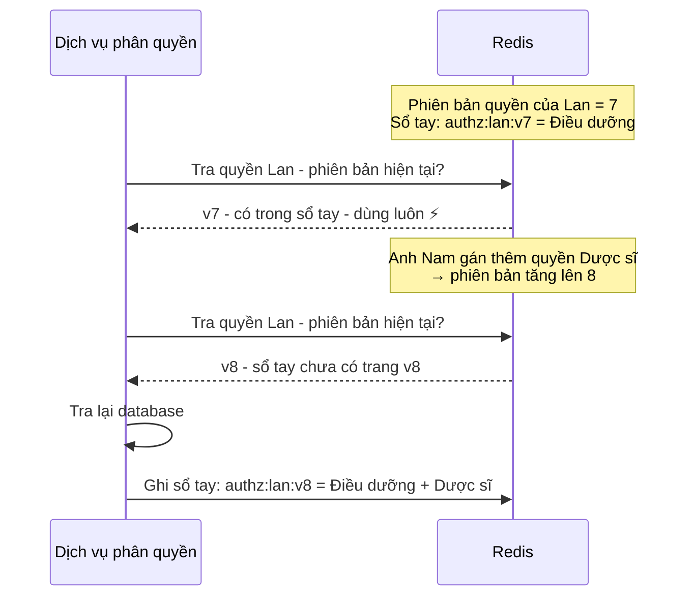

Thay vì phải đi tìm và xóa từng dòng cũ, ta chỉ cần **tăng số phiên bản**. Mọi dòng cũ (`v7`) tự nhiên không còn ai đọc nữa, và sẽ tự hết hạn sau vài phút.

### 9.3 Hai loại sổ tay khác nhau

| | Sổ tay Lớp 1 (role, permission) | Sổ tay Lớp 2 (lịch trực hiện tại) |
|---|---|---|
| Thay đổi | Hiếm | Mỗi ca |
| Giữ trong bao lâu | Đến khi phiên bản đổi (tối đa vài phút) | 1–5 phút |
| Lý do tách riêng | Nếu gộp chung, mỗi lần đổi ca sẽ làm mất luôn sổ tay Lớp 1 |

---

## Phần 10. Một ngày làm việc: tổng hợp các tình huống

Thứ Hai 09/11/2026, Cơ sở Cầu Giấy.

| Giờ | Ai | Muốn làm gì | Kết quả | Vì sao |
|---|---|---|---|---|
| 07:00 | Chị Hoa | Tiếp nhận Bà Mai, xếp vào hàng chờ Nội 3 | ✅ | Có `patient.create`, `queue.add` tại Quầy tiếp đón |
| 07:05 | Chị Hoa | Xem chẩn đoán lần khám trước của Bà Mai | ❌ | Tiếp đón không có `patient.clinical.read` |
| 09:00 | BS Minh | Mở hàng chờ | ✅ Thấy 20 người ở Nội 3 | Lớp 1 + lịch trực Nội 3 |
| 09:00 | BS Minh | Xem bệnh án Bà Mai | ✅ | Bà Mai chờ ở phòng BS Minh đang trực |
| 09:10 | BS Minh | Kê đơn cho Bà Mai | ✅ | Có `prescription.create` + đang khám Bà Mai |
| 09:15 | Hộ lý Hùng | Xem nhiệm vụ đưa Bà Mai đi xét nghiệm | ✅ | Có `task.view`, chỉ thấy tên và nơi cần đến |
| 09:16 | Hộ lý Hùng | Mở chẩn đoán của Bà Mai | ❌ | Luật cấm cứng: hộ lý không bao giờ xem dữ liệu lâm sàng |
| 09:30 | Anh Tú | Cấp phát thuốc theo đơn của BS Minh | ✅ | Có `prescription.dispense` tại Kho dược |
| 10:00 | Anh Tú | Điều chỉnh tồn kho do thuốc vỡ | ✅ | Có `inventory.adjust` |
| 10:01 | Anh Tú | Tự duyệt phiếu điều chỉnh vừa tạo | ❌ | Quy tắc tách nhiệm vụ: không được tự duyệt phiếu của mình |
| 10:30 | Anh Nam | Duyệt phiếu điều chỉnh của Anh Tú | ✅ | Có `inventory.adjust.approve`, không phải người tạo phiếu |
| 14:00 | BS Minh | Xem bệnh nhân mới ở Nội 3 | ❌ | Đã chuyển sang trực Nội 5 |
| 14:05 | BS Minh | Xem kết quả xét nghiệm của Bà Mai | ✅ | Đã khám Bà Mai sáng nay |
| 15:00 | BS Minh | Xem hồ sơ bệnh nhân ngất ở hành lang | ✅ qua khẩn cấp | Break-glass, Anh Nam nhận cảnh báo |
| 16:00 | Chị Thu | Xem báo cáo doanh thu Cầu Giấy và Hà Đông | ✅ | Gán ở Miền Bắc, kế thừa xuống |
| 16:05 | Chị Thu | Xem báo cáo cơ sở Quận 1 | ❌ | Quận 1 thuộc Miền Nam |
| 16:10 | Anh Nam | Xem báo cáo cơ sở Hà Đông | ❌ | Chỉ được gán ở Cầu Giấy |
| 09:40 | Máy LIS Cầu Giấy | Gửi kết quả xét nghiệm của Bà Mai | ✅ | Hệ thống có `lab_result.submit`, chỉ định gửi đúng phòng XN Cầu Giấy *(Phần 13.6)* |
| 09:41 | Máy LIS Cầu Giấy | Đọc bệnh án Bà Mai | ❌ | Role `lab_device` không có `patient.clinical.read` *(Phần 13.6)* |
| 10:15 | BS Đức | Kê đơn cho bệnh nhân ở Nội 5 | ❌ | Có role, đang trực, nhưng chứng chỉ hành nghề hết hạn *(Phần 13.4)* |
| 10:16 | BS Đức | Xem bệnh án bệnh nhân ở Nội 5 | ✅ | Xem bệnh án không yêu cầu kiểm tra chứng chỉ *(Phần 13.4)* |
| 11:00 | BS Minh | Lưu chẩn đoán có mã thuộc nhóm nhạy cảm | ✅ | Hồ sơ tự động gắn nhãn nhạy cảm; Y tá Lan sẽ không thấy mục này *(Phần 13.8)* |

---

## Phần 11. Bảng thuật ngữ

| Thuật ngữ | Viết tắt | Giải thích dễ hiểu |
|---|---|---|
| Authentication | AuthN | **Xác thực** — chứng minh "bạn là ai" (đăng nhập) |
| Authorization | AuthZ | **Phân quyền** — quyết định "bạn được làm gì" |
| Identity Provider | IdP | Hệ thống chuyên lo đăng nhập, ví dụ Keycloak, Microsoft Entra ID |
| OpenID Connect | OIDC | Chuẩn giao tiếp đăng nhập giữa ứng dụng và IdP |
| Multi-Factor Authentication | MFA | Đăng nhập nhiều bước: mật khẩu + mã OTP |
| Token / JWT | — | "Thẻ nhân viên điện tử" do IdP cấp, gửi kèm mỗi yêu cầu |
| Tenant | — | Một khách hàng dùng phần mềm; dữ liệu giữa các tenant tách biệt hoàn toàn |
| Multi-tenant | — | Một phần mềm phục vụ nhiều khách hàng cùng lúc |
| Facility | — | Cơ sở vật lý |
| Unit | — | Đơn vị bên trong cơ sở: phòng khám, quầy, kho |
| Permission | — | Một quyền cụ thể — một "chiếc chìa khóa" |
| Role | — | Một nhóm permission — một "chùm chìa khóa" |
| Role Assignment | — | Giao role cho người, ở phạm vi nào, đến khi nào |
| Scope | — | Phạm vi áp dụng quyền: tenant, vùng, cơ sở, hay phòng |
| RBAC | Role-Based Access Control | Phân quyền dựa trên **vai trò** |
| ABAC | Attribute-Based Access Control | Phân quyền dựa trên **thuộc tính/ngữ cảnh**, ví dụ giờ, ca trực, phòng |
| ReBAC | Relationship-Based Access Control | Phân quyền dựa trên **mối quan hệ**, ví dụ "bác sĩ đang điều trị bệnh nhân này" |
| Policy | — | Một quy tắc phân quyền viết thành văn bản/code |
| Policy Engine | — | Phần mềm đọc và thực thi policy, ví dụ Cedar, OPA, OpenFGA |
| PDP | Policy Decision Point | **Nơi ra quyết định** — ở đây là Dịch vụ phân quyền |
| PEP | Policy Enforcement Point | **Nơi thực thi quyết định** — Cổng API, service, database |
| Duty Roster | — | Lịch phân công trực |
| Encounter | — | Một lượt khám bệnh |
| Care Team | — | Nhóm nhân viên y tế đang điều trị cho một bệnh nhân |
| Row-Level Security | RLS | Tính năng database tự lọc dòng dữ liệu theo quy tắc |
| Cache | — | Bộ nhớ tạm để tra cứu nhanh — "cuốn sổ tay" |
| Redis | — | Phần mềm cache phổ biến |
| TTL | Time To Live | Thời gian một dòng trong cache tồn tại trước khi tự xóa |
| Epoch / Version | — | Số phiên bản quyền, tăng lên mỗi khi quyền thay đổi |
| Outbox | — | Bảng "hộp thư sự kiện" ghi lại các thay đổi để xử lý sau |
| Break-glass | — | Truy cập khẩn cấp, được phép nhưng bị ghi lại và cảnh báo |
| Separation of Duties | SoD | Tách nhiệm vụ: người tạo không được tự duyệt |
| Field masking | — | Che bớt một số trường dữ liệu tùy người xem |
| Least Privilege | — | Nguyên tắc: chỉ cấp **vừa đủ** quyền cần thiết cho công việc |
| Zero Trust | — | Nguyên tắc: không tin mặc định, kiểm tra mọi yêu cầu |
| Deny by default | — | Mặc định từ chối; chỉ cho phép khi có quy tắc cho phép rõ ràng |
| Audit Log | — | Nhật ký ghi lại ai đã làm gì, lúc nào |
| SIEM | — | Hệ thống giám sát an ninh, phân tích nhật ký để phát hiện bất thường |
| 401 Unauthorized | — | Mã lỗi HTTP: "bạn chưa đăng nhập / token không hợp lệ" |
| 403 Forbidden | — | Mã lỗi HTTP: "bạn đã đăng nhập nhưng không có quyền" |
| OpenHIE | Open Health Information Exchange | Framework kiến trúc mẫu cho việc trao đổi dữ liệu y tế giữa nhiều hệ thống *(Phần 13)* |
| HIE | Health Information Exchange | Hạ tầng trao đổi thông tin y tế giữa nhiều đơn vị |
| HL7 FHIR | — | Bộ chuẩn dữ liệu y tế phổ biến nhất hiện nay; định nghĩa cấu trúc cho bệnh nhân, nhân viên, cơ sở... |
| Organization / Location | — | Khái niệm FHIR cho tổ chức (Tenant, Facility) và địa điểm vật lý (Unit) |
| Practitioner | — | Khái niệm FHIR cho **người hành nghề y**: họ tên, chứng chỉ, phạm vi hành nghề |
| PractitionerRole | — | Khái niệm FHIR: người hành nghề làm vai trò gì, ở đâu, trong thời gian nào |
| HWR | Health Worker Registry | Danh bạ gốc nhân viên y tế |
| FR | Facility Registry | Danh bạ gốc cơ sở y tế |
| CR / MPI | Client Registry / Master Patient Index | Danh bạ gốc bệnh nhân; nhận ra nhiều mã định danh là cùng một người |
| IOL | Interoperability Layer | Lớp tương tác: cổng duy nhất cho mọi giao tiếp giữa các hệ thống |
| mCSD | Mobile Care Services Discovery | Chuẩn truy vấn danh bạ tổ chức, cơ sở, nhân viên y tế, dựa trên FHIR |
| ATNA | Audit Trail and Node Authentication | Chuẩn của IHE về nhật ký truy cập và xác thực máy |
| AuditEvent | — | Định dạng FHIR cho một dòng nhật ký truy cập |
| NTP | Network Time Protocol | Giao thức đồng bộ giờ giữa các máy chủ |
| ICD-10 | — | Bảng mã phân loại bệnh quốc tế |
| Terminology Service | TS | Dịch vụ quản lý các bộ mã chuẩn như ICD-10 |
| Client credentials | — | Cách một **hệ thống** (không phải người) đăng nhập bằng mã bí mật của ứng dụng |
| mTLS | Mutual TLS | Kết nối mã hóa mà **cả hai phía** đều phải trình chứng chỉ số; dùng để xác thực máy |

---

## Phần 12. Câu hỏi thường gặp

**Hỏi: Tạo role mới có phải sửa code không?**
Không. Admin tạo role trên màn hình và chọn các permission có sẵn. Chỉ khi có **tính năng mới** cần permission mới thì mới sửa code.

**Hỏi: Sao không lưu quyền theo đường dẫn API (ví dụ `GET /api/invoices`)?**
Vì đường dẫn là chi tiết kỹ thuật, hay thay đổi khi sửa code, và không trả lời được câu hỏi "xem bệnh nhân **nào**". Một hành động như "duyệt hoàn tiền" có thể đi qua nhiều đường dẫn khác nhau trên web và mobile. Permission đặt theo nghiệp vụ thì ổn định hơn và admin dễ hiểu hơn.

**Hỏi: Nếu lịch trực nhập sai thì bác sĩ bị chặn à?**
Đúng, đây là rủi ro của Lớp 2. Cách giảm thiểu:
- cho phép **ân hạn** 15 phút trước ca và 30 phút sau ca;
- bác sĩ **tự xác nhận phòng** khi bắt đầu ca nếu lịch chưa có, kèm thông báo cho điều phối;
- trường hợp gấp vẫn có **truy cập khẩn cấp**.

**Hỏi: Một bác sĩ làm ở 2 cơ sở thì sao?**
Tạo 2 dòng `role_assignments`, mỗi dòng một cơ sở. Khi đăng nhập, bác sĩ chọn cơ sở làm việc hôm nay.

**Hỏi: Thêm một chuỗi phòng khám mới (tenant mới) thì làm gì?**
Tạo tenant mới, các role chung (Bác sĩ, Y tá...) đã có sẵn. Tenant mới có thể tự tạo thêm role riêng từ danh sách permission có sẵn. Database tự tách dữ liệu nhờ RLS.

**Hỏi: Vì sao phải ghi nhật ký cả khi chỉ xem?**
Dữ liệu sức khỏe là dữ liệu nhạy cảm theo pháp luật về bảo vệ dữ liệu cá nhân. Bệnh nhân có quyền biết ai đã xem hồ sơ của mình, và khi xảy ra rò rỉ, nhật ký là bằng chứng duy nhất để điều tra.

**Hỏi: Có bắt buộc phải theo OpenHIE không?**
Không. OpenHIE là kiến trúc tham khảo, không phải quy định bắt buộc. Tuy nhiên, các bổ sung ở Phần 13.4 (tách hồ sơ hành nghề) và 13.7 (đồng bộ giờ) nên làm ngay vì rẻ và khó sửa về sau. Các phần còn lại làm khi bắt đầu tích hợp với hệ thống bên ngoài.

**Hỏi: Máy xét nghiệm, máy chụp chiếu có cần tài khoản không?**
Có, nhưng là tài khoản **hệ thống**, đăng nhập bằng mã bí mật và chứng chỉ số thay vì mật khẩu. Mỗi máy có role và phạm vi riêng, chỉ làm được đúng việc của nó (Phần 13.6).

**Hỏi: Bác sĩ hết hạn chứng chỉ hành nghề thì hệ thống xử lý thế nào?**
Bác sĩ vẫn đăng nhập và xem bệnh án được, nhưng các hành động chuyên môn như kê đơn sẽ bị chặn tự động cho đến khi chứng chỉ được cập nhật (Phần 13.4).

**Hỏi: Tôi cần học gì để triển khai được?**
Theo thứ tự: (1) cách framework của bạn làm authorization, ví dụ ASP.NET Core Authorization Policy; (2) JWT và OIDC cơ bản; (3) Redis cơ bản; (4) PostgreSQL Row-Level Security; (5) outbox pattern; (6) khi cần tích hợp: HL7 FHIR cơ bản, đặc biệt các resource `Patient`, `Practitioner`, `PractitionerRole`, `Organization`, `Location`, `AuditEvent`.

---

## Phần 13. Mở rộng theo OpenHIE — khi hệ thống cần "nói chuyện" với hệ thống khác

### 13.1 OpenHIE là gì?

**OpenHIE** (Open Health Information Exchange) là một cộng đồng quốc tế xây dựng **kiến trúc mẫu cho việc trao đổi dữ liệu y tế giữa nhiều hệ thống**, thường ở quy mô quốc gia. Tài liệu chính thức là *OpenHIE Architecture Specification*, hiện ở phiên bản 5.2, tại https://guides.ohie.org/arch-spec.

So sánh dễ hiểu:

| | Phần 1–12 của tài liệu này | OpenHIE |
|---|---|---|
| Giống như | **Nội quy bên trong một tòa nhà**: ai được vào phòng nào | **Quy ước chung giữa các tòa nhà trong thành phố**: danh bạ chung, bưu điện chung, sổ hộ khẩu chung |
| Trả lời câu hỏi | "Bên trong hệ thống của tôi, ai được làm gì?" | "Hệ thống của tôi trao đổi dữ liệu với hệ thống khác thế nào cho an toàn và thống nhất?" |

OpenHIE **không thay thế** thiết kế phân quyền ở các phần trước. Về phân quyền người dùng, OpenHIE chỉ khuyến nghị chung là nên có phân quyền theo vai trò. Giá trị của OpenHIE nằm ở **hai chỗ khác**:

1. Cách tổ chức **dữ liệu gốc**: ai là nhân viên y tế, đâu là cơ sở, ai là bệnh nhân.
2. Cách bảo vệ **giao tiếp giữa các hệ thống**: máy xét nghiệm, máy chụp chiếu, cổng BHYT, hệ thống của đối tác.

### 13.2 Các thành phần của OpenHIE

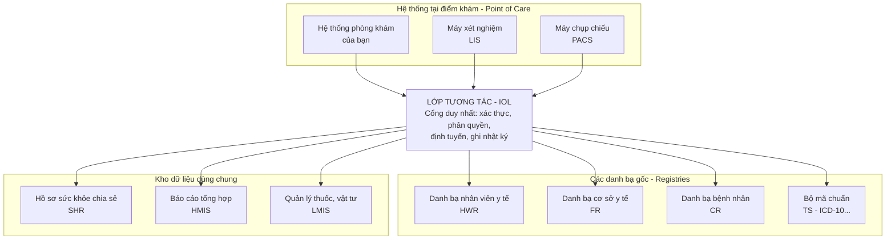

### 13.3 Đối chiếu với thiết kế hiện tại

| Thành phần OpenHIE | Nhiệm vụ | Thiết kế hiện tại đã có | Bổ sung trong chương này |
|---|---|---|---|
| **HWR** — Health Worker Registry | Danh bạ gốc nhân viên y tế | `users`, `role_assignments` | **13.4** Tách hồ sơ hành nghề, kiểm tra chứng chỉ |
| **FR** — Facility Registry | Danh bạ gốc cơ sở y tế | `facilities`, `units` | **13.5** Chuẩn hóa theo FHIR |
| **CR** — Client Registry | Định danh bệnh nhân duy nhất | Bệnh nhân ở cấp Tenant | **13.5** Liên kết nhiều mã định danh |
| **IOL** — Interoperability Layer | Cổng giao tiếp giữa các hệ thống | Chỉ phân quyền cho **người** | **13.6** Phân quyền cho **hệ thống** |
| **ATNA + Consistent Time** | Nhật ký chuẩn, đồng bộ giờ | Có nhật ký | **13.7** Chuẩn hóa nhật ký, đồng bộ giờ |
| **TS** — Terminology Service | Bộ mã chuẩn | Chưa có | **13.8** Tự động nhận diện dữ liệu nhạy cảm |

Thêm hai nhân vật mới cho các ví dụ trong chương này:

| Nhân vật | Mô tả |
|---|---|
| **BS Đức** | Bác sĩ nội khoa ở Cầu Giấy, **chứng chỉ hành nghề vừa hết hạn** hôm qua |
| **Máy LIS Cầu Giấy** | Hệ thống xét nghiệm của Cơ sở Cầu Giấy — một **hệ thống**, không phải người |

---

### 13.4 Bổ sung 1 — Tách "hồ sơ hành nghề" khỏi "tài khoản đăng nhập"

#### Vấn đề

Hiện tại, bảng `users` vừa là **tài khoản đăng nhập** vừa ngầm là **người hành nghề**. Hai thứ này khác nhau:

| | Tài khoản đăng nhập | Hồ sơ hành nghề |
|---|---|---|
| So sánh đời thường | **Thẻ ra vào** tòa nhà | **Chứng chỉ hành nghề** treo trên tường phòng khám |
| Chứa gì | Tên đăng nhập, mật khẩu, MFA | Họ tên, số chứng chỉ, phạm vi hành nghề, ngày hết hạn |
| Ai quản lý | Bộ phận IT | Bộ phận nhân sự / chuyên môn |
| Một người có thể có | Nhiều tài khoản (mỗi tenant một tài khoản) | **Đúng một** hồ sơ hành nghề |

OpenHIE định nghĩa Health Worker Registry là **nguồn chính thức duy nhất** lưu định danh nhân viên y tế, với API theo chuẩn **mCSD** — chuẩn này xây dựng trên **HL7 FHIR**, bộ chuẩn dữ liệu y tế phổ biến nhất hiện nay.

#### Cách FHIR tổ chức — khớp gần như hoàn toàn với thiết kế của bạn

| Khái niệm FHIR | Nghĩa | Tương ứng trong thiết kế |
|---|---|---|
| `Organization` | Tổ chức | Tenant, Facility |
| `Location` | Địa điểm vật lý | Unit — phòng khám, kho, quầy |
| `Practitioner` | **Con người** hành nghề | **Bảng mới** `practitioners` |
| `PractitionerRole` | Người đó làm vai trò gì, ở đâu, chuyên khoa gì, từ khi nào đến khi nào | `role_assignments` + `duty_rosters` |

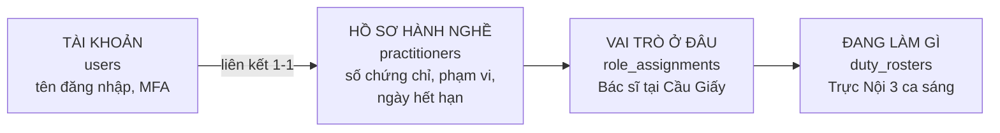

#### Bảng mới

```text
practitioners
┌────────────┬───────────┬──────────────────┬──────────────┬────────────┬─────────┐
│ id         │ full_name │ license_no       │ scope        │ license_to │ status  │
├────────────┼───────────┼──────────────────┼──────────────┼────────────┼─────────┤
│ prac-minh  │ BS Minh   │ 012345/HNO-CCHN  │ Nội khoa     │ 2030-05-01 │ active  │
│ prac-duc   │ BS Đức    │ 067890/HNO-CCHN  │ Nội khoa     │ 2026-11-08 │ active  │
│ prac-lan   │ Y tá Lan  │ 054321/HNO-CCHN  │ Điều dưỡng   │ 2029-01-15 │ active  │
└────────────┴───────────┴──────────────────┴──────────────┴────────────┴─────────┘

users
┌───────────────┬────────────┬───────────────┐
│ id            │ username   │ practitioner  │
├───────────────┼────────────┼───────────────┤
│ user-bs-minh  │ minh.nv    │ prac-minh     │
│ user-bs-duc   │ duc.tt     │ prac-duc      │
│ user-chi-hoa  │ hoa.lt     │ (không có)    │  ← tiếp đón, không hành nghề y
└───────────────┴────────────┴───────────────┘
```

#### Quy tắc phân quyền mới: chứng chỉ hành nghề là một điều kiện

Một số hành động **chuyên môn** đòi hỏi thêm điều kiện về chứng chỉ, ngoài role và lịch trực:

| Hành động | Lớp 1: Role | Lớp 2: Lịch trực | **Lớp mới: Chứng chỉ** |
|---|---|---|---|
| Xem bệnh án | ✅ cần | ✅ cần | Không cần |
| Kê đơn thuốc | ✅ cần | ✅ cần | ✅ **Còn hạn + đúng phạm vi** |
| Chỉ định thủ thuật | ✅ cần | ✅ cần | ✅ **Còn hạn + đúng phạm vi** |
| Ký kết quả | ✅ cần | ✅ cần | ✅ **Còn hạn** |

> ⚖️ **Lưu ý pháp lý:** pháp luật Việt Nam về khám bệnh, chữa bệnh có quy định về giấy phép hành nghề và phạm vi hành nghề. Danh sách hành động nào cần kiểm tra chứng chỉ cần được bộ phận chuyên môn và pháp chế xác nhận. Về kiến trúc, hệ thống chỉ cần có **khả năng** kiểm tra tự động.

#### Luồng: BS Đức kê đơn khi chứng chỉ đã hết hạn

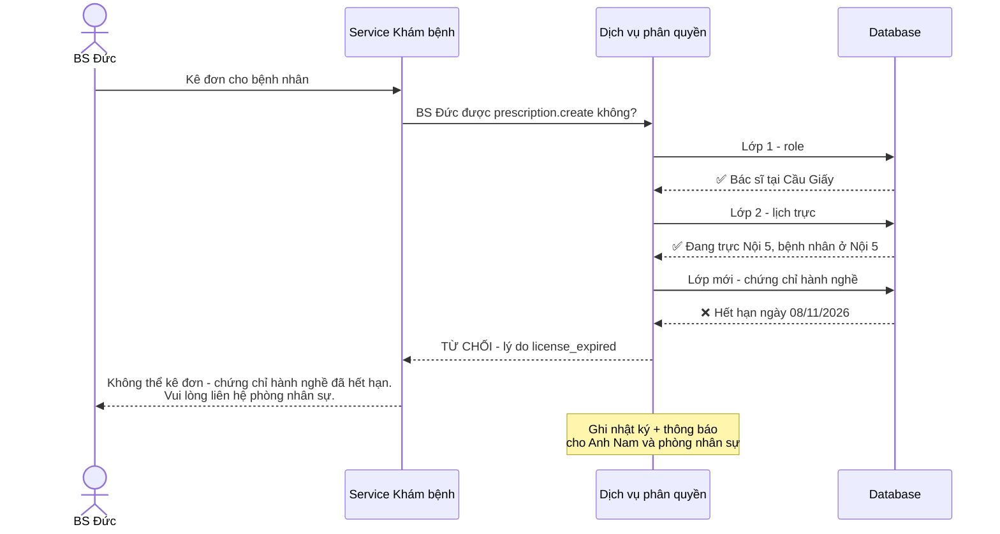

BS Đức **vẫn xem được bệnh án** để hỗ trợ đồng nghiệp, nhưng **không kê đơn được**. Không ai phải nhớ đi thu hồi quyền — ngày hết hạn trong hồ sơ tự làm việc đó.

**Mã giả trong policy:**

```csharp
// Thêm vào quy tắc cho prescription.create
bool LicenseOk(Practitioner p, Prescription rx, DateTime now) =>
       p.Status == "active"
    && p.LicenseTo > now
    && p.Scope.Covers(rx.Specialty);   // ví dụ: Nội khoa không kê đơn chuyên khoa Mắt
```

---

### 13.5 Bổ sung 2 — Chuẩn hóa cơ sở và bệnh nhân theo FHIR

#### Cơ sở và phòng (theo Facility Registry)

Chỉ cần **đặt tên cột sao cho chuyển được sang FHIR** và thêm mã chính thức. Làm từ đầu thì gần như không tốn thêm công; sửa về sau thì rất tốn.

```text
facilities                                    → FHIR Organization
┌──────────────┬────────────────┬──────────────────┬─────────────┐
│ id           │ name           │ official_code    │ parent_id   │
├──────────────┼────────────────┼──────────────────┼─────────────┤
│ fac-cau-giay │ Cơ sở Cầu Giấy │ (mã cơ sở KCB)   │ region-bac  │
└──────────────┴────────────────┴──────────────────┴─────────────┘

units                                         → FHIR Location
┌──────────┬──────────────┬──────────────┬──────────────────┐
│ id       │ facility_id  │ unit_type    │ physical_type    │
├──────────┼──────────────┼──────────────┼──────────────────┤
│ U1       │ fac-cau-giay │ exam_room    │ ro (room)        │
│ U6       │ fac-cau-giay │ pharmacy     │ ro (room)        │
└──────────┴──────────────┴──────────────┴──────────────────┘
```

Cột `official_code` dùng cho mã cơ sở khám chữa bệnh chính thức mà cơ quan BHXH/Sở Y tế cấp. Khi cần liên thông, dữ liệu đã sẵn sàng.

#### Bệnh nhân (theo Client Registry)

Cùng một người có thể có nhiều mã: số CCCD, mã thẻ BHYT, mã bệnh nhân cũ ở từng cơ sở trước khi về chung một hệ thống. Client Registry giải quyết việc **nhận ra đó là cùng một người**.

```text
patient_identifiers                           → FHIR Patient.identifier
┌──────────────┬──────────────┬──────────────────────┐
│ patient_id   │ system       │ value                │
├──────────────┼──────────────┼──────────────────────┤
│ pat-ba-mai   │ cccd         │ 001xxxxxxxxx         │
│ pat-ba-mai   │ bhyt         │ HN40xxxxxxxxxxx      │
│ pat-ba-mai   │ legacy-cg    │ CG-2019-00123        │  ← mã cũ ở Cầu Giấy
└──────────────┴──────────────┴──────────────────────┘
```

**Liên quan đến phân quyền thế nào?** Nếu Bà Mai bị tạo **trùng hồ sơ** (một hồ sơ ở Cầu Giấy, một ở Hà Đông), bác sĩ sẽ không thấy tiền sử dị ứng ở hồ sơ kia — rủi ro an toàn người bệnh. Thao tác **gộp hồ sơ trùng** là thao tác nguy hiểm nên cần permission riêng `patient.merge`, chỉ cấp cho vài người, và bắt buộc ghi nhật ký.

---

### 13.6 Bổ sung 3 — Phân quyền cho hệ thống, không chỉ cho người

#### Vấn đề

Phần 1–12 chỉ nói về **người dùng**. Nhưng 1.000 cơ sở sẽ có rất nhiều **hệ thống** gọi API của bạn:

| Hệ thống | Làm gì |
|---|---|
| Máy xét nghiệm (LIS) | Gửi kết quả xét nghiệm vào hồ sơ |
| Máy chụp chiếu (PACS) | Gửi hình ảnh, kết luận |
| Cổng giám định BHYT | Nhận dữ liệu thanh toán |
| App đặt lịch của đối tác | Tạo lịch hẹn |

OpenHIE yêu cầu **Lớp tương tác (IOL)** phải xác thực và phân quyền cho các hệ thống gửi dữ liệu vào, và được thiết kế làm **điểm vào duy nhất**, tự xử lý định tuyến, bảo mật và ghi nhật ký cho mọi luồng.

#### So sánh đời thường

Người giao hàng đến tòa nhà không có thẻ nhân viên, mà có **thẻ khách đặc biệt**: chỉ được vào khu nhận hàng, chỉ trong giờ hành chính, không được lên tầng văn phòng.

Tương tự, mỗi hệ thống bên ngoài được coi là **một "user đặc biệt"** với role và scope riêng. Mô hình Permission + Role + Scope ở Phần 4–5 **dùng lại được hoàn toàn**.

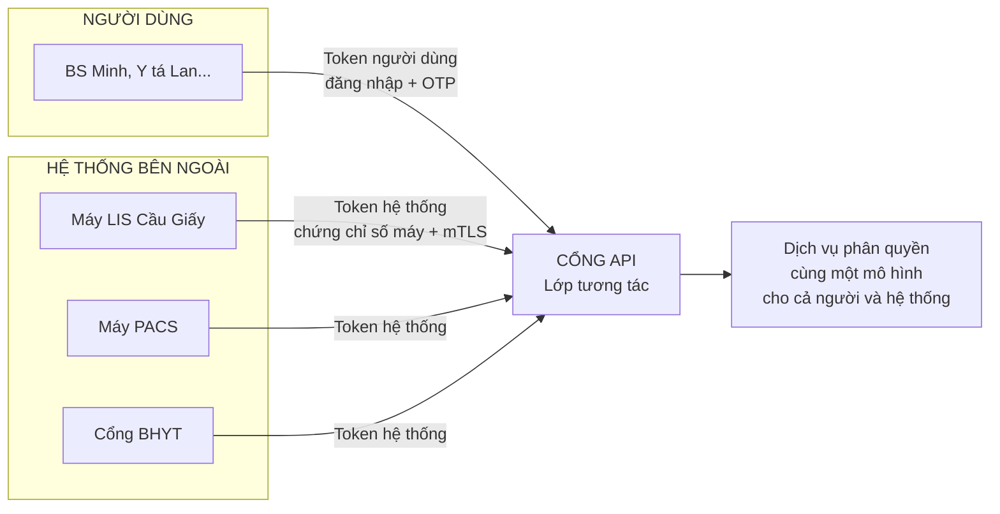

#### Người và hệ thống đăng nhập khác nhau thế nào

| | Người dùng | Hệ thống |
|---|---|---|
| Chứng minh danh tính bằng | Mật khẩu + OTP | **Client credentials** (mã bí mật của ứng dụng) + **mTLS** (chứng chỉ số gắn với máy) |
| Có lịch trực không | Có (bác sĩ, y tá) | Không |
| Role ví dụ | Bác sĩ, Tiếp đón | `lab_device`, `imaging_device`, `insurance_gateway` |
| Scope ví dụ | Cơ sở Cầu Giấy | Chỉ Phòng xét nghiệm của Cầu Giấy |

#### Bảng đăng ký hệ thống

```text
system_clients
┌──────────────────┬──────────────────┬────────────┬──────────────────────┐
│ id               │ name             │ role       │ scope                │
├──────────────────┼──────────────────┼────────────┼──────────────────────┤
│ sys-lis-cg       │ Máy LIS Cầu Giấy │ lab_device │ unit: XN Cầu Giấy    │
│ sys-pacs-cg      │ PACS Cầu Giấy    │ imaging    │ unit: CĐHA Cầu Giấy  │
│ sys-bhyt         │ Cổng BHYT        │ ins_gw     │ tenant: An Tâm       │
└──────────────────┴──────────────────┴────────────┴──────────────────────┘

Role lab_device CHỈ có:
  ✅ lab_order.read           (đọc chỉ định xét nghiệm gửi đến phòng mình)
  ✅ lab_result.submit        (gửi kết quả)
  ❌ patient.clinical.read    (KHÔNG được đọc bệnh án)
```

#### Luồng: Máy LIS gửi kết quả xét nghiệm của Bà Mai

```mermaid
sequenceDiagram
    participant LIS as Máy LIS Cầu Giấy
    participant GW as Cổng API
    participant AZ as Dịch vụ phân quyền
    participant SVC as Service Xét nghiệm
    participant DB as Database
    participant LOG as Nhật ký

    LIS->>GW: Gửi kết quả xét nghiệm Bà Mai<br/>kèm token hệ thống + chứng chỉ số máy
    GW->>GW: Bước 1 - chứng chỉ số máy hợp lệ?<br/>token hệ thống còn hạn?
    GW->>AZ: Bước 2 - sys-lis-cg được lab_result.submit<br/>cho chỉ định này không?
    AZ->>DB: Chỉ định xét nghiệm này gửi đến<br/>phòng XN Cầu Giấy?
    DB-->>AZ: ✅ Đúng
    AZ-->>GW: CHO PHÉP
    GW->>SVC: Chuyển tiếp
    SVC->>DB: Lưu kết quả
    SVC->>LOG: Ghi nhật ký - người thực hiện là hệ thống sys-lis-cg
```

**Nếu máy LIS bị chiếm quyền điều khiển** và kẻ tấn công cố đọc bệnh án: `patient.clinical.read` không có trong role `lab_device` → bị từ chối. Thiệt hại bị giới hạn trong phạm vi nhỏ nhất.

---

### 13.7 Bổ sung 4 — Nhật ký chuẩn và đồng bộ giờ

#### Nhật ký theo chuẩn

OpenHIE dùng chuẩn **ATNA** (Audit Trail and Node Authentication) cho nhật ký. Phiên bản hiện đại của chuẩn này dùng định dạng **FHIR AuditEvent**. Thay vì tự đặt cấu trúc nhật ký như ở Phần 7.9, nên đặt theo cấu trúc chuẩn để sau này tích hợp với hệ thống giám sát hoặc cơ quan quản lý mà không phải chuyển đổi.

So sánh nhật ký ở Phần 7.9 với dạng chuẩn hóa (đã đơn giản hóa):

```json
{
  "resourceType": "AuditEvent",
  "recorded": "2026-11-09T09:00:12+07:00",
  "action": "R",
  "outcome": "0",
  "agent": [{
    "who": { "reference": "Practitioner/prac-minh" },
    "requestor": true,
    "network": { "address": "10.2.15.33" }
  }],
  "source": { "observer": { "reference": "Organization/fac-cau-giay" } },
  "entity": [{ "what": { "reference": "Patient/pat-ba-mai" } }],
  "purposeOfEvent": [{ "text": "on_duty_unit:noi-3" }]
}
```

| Trường | Nghĩa | Tương ứng Phần 7.9 |
|---|---|---|
| `recorded` | Thời điểm | `time` |
| `action` | `C` tạo, `R` đọc, `U` sửa, `D` xóa | `action` |
| `outcome` | `0` thành công, khác `0` thất bại | `decision` |
| `agent.who` | Ai làm — người hoặc hệ thống | `user` |
| `entity.what` | Làm với dữ liệu nào | `patient` |
| `purposeOfEvent` | Vì sao được phép | `reason` |

#### Đồng bộ giờ — quan trọng hơn bạn nghĩ

OpenHIE có chuẩn **Consistent Time**, yêu cầu đồng hồ các máy trong mạng lệch nhau dưới 1 giây.

**Vì sao quan trọng với thiết kế này?** Vì Lớp 2 (Phần 6) ra quyết định **dựa trên giờ**: "BS Minh có đang trong ca trực không?". Ví dụ khi đồng hồ máy chủ ở Hà Đông chạy **chậm 10 phút**:

Ca trực của BS Minh kết thúc 11:30, ân hạn 30 phút, tức được truy cập đến **12:00**.

| Giờ thật | Máy chủ nghĩ là | Quyết định | Đúng hay sai |
|---|---|---|---|
| 11:55 | 11:45 | Cho phép | ✅ Đúng — còn trong ân hạn |
| 12:05 | 11:55 | Cho phép | ⚠️ **Sai** — đã quá ân hạn 5 phút |
| 12:09 | 11:59 | Cho phép | ⚠️ **Sai** — đã quá ân hạn 9 phút |

Thêm nữa, nhật ký ghi sai giờ 10 phút → khi điều tra sự cố, thời gian không khớp với camera và không khớp với nhật ký của máy chủ khác.

**Quy tắc bắt buộc:**

1. Mọi máy chủ đồng bộ giờ tự động qua **NTP**.
2. Quyết định phân quyền theo giờ **chỉ dùng giờ của máy chủ**, không bao giờ dùng giờ gửi lên từ điện thoại hay máy tính của người dùng (người dùng có thể tự chỉnh giờ máy).
3. Giám sát độ lệch giờ; cảnh báo khi lệch quá 1 giây.

---

### 13.8 Bổ sung 5 — Tự động nhận diện dữ liệu nhạy cảm theo mã bệnh

> Phần này là gợi ý thiết kế xuất phát từ thành phần Terminology Service của OpenHIE, không phải yêu cầu trực tiếp của OpenHIE.

#### Vấn đề

Phần 7.5 có permission `patient.sensitive.read`. Nhưng **hệ thống biết dữ liệu nào là nhạy cảm bằng cách nào?** Nếu để bác sĩ tự đánh dấu, sẽ có lúc quên — và dữ liệu nhạy cảm bị lộ cho người không nên thấy.

#### Giải pháp: dựa vào mã chẩn đoán chuẩn

Mỗi chẩn đoán đều có mã **ICD-10**. Bộ phận chuyên môn định nghĩa một lần bảng "nhóm mã nào là nhạy cảm". Khi bác sĩ lưu chẩn đoán, hệ thống **tự động gắn nhãn**.

```mermaid
flowchart LR
    A["BS Minh nhập chẩn đoán<br/>mã ICD-10"] --> B{"Tra bảng<br/>mã nhạy cảm"}
    B -- "Không nằm trong danh sách" --> C["Nhãn: bình thường"]
    B -- "Nằm trong danh sách" --> D["Nhãn: NHẠY CẢM<br/>tự động"]
    C --> E[("Lưu hồ sơ")]
    D --> E
    E --> F["Khi ai đó mở hồ sơ:<br/>bộ lọc ở Phần 7.5<br/>đọc nhãn để quyết định<br/>hiển thị hay che"]
```

```text
sensitivity_rules  (do bộ phận chuyên môn quản lý — ví dụ minh họa)
┌──────────────┬─────────────────────────┬──────────────┐
│ code_range   │ nhóm                    │ nhãn         │
├──────────────┼─────────────────────────┼──────────────┤
│ B20–B24      │ HIV                     │ restricted   │
│ F00–F99      │ Rối loạn tâm thần       │ sensitive    │
│ ...          │ (chuyên môn quyết định) │ ...          │
└──────────────┴─────────────────────────┴──────────────┘
```

Lợi ích: **an toàn theo mặc định**. Bác sĩ không cần nhớ đánh dấu. Khi bộ phận chuyên môn bổ sung nhóm mã mới vào bảng, toàn bộ hồ sơ có mã đó tự động được bảo vệ theo.

---

### 13.9 Kiến trúc sau khi bổ sung OpenHIE

So sánh với bản đồ tổng thể ở Phần 7.1, các thành phần **mới** được đánh dấu ⭐:

```mermaid
flowchart TD
    APP["📱 Ứng dụng"]
    EXT["⭐ Hệ thống bên ngoài<br/>LIS, PACS, Cổng BHYT"]
    IDP["🪪 Hệ thống đăng nhập<br/>người + ⭐ hệ thống"]
    GW["🚪 Cổng API<br/>= Lớp tương tác OpenHIE"]
    SVC["⚙️ Service nghiệp vụ"]
    AUTHZ["⚖️ Dịch vụ phân quyền<br/>Lớp 1 + Lớp 2 + ⭐ chứng chỉ"]
    REG["⭐ Danh bạ gốc<br/>practitioners, facilities,<br/>units, patient_identifiers"]
    TS["⭐ Bộ mã chuẩn<br/>ICD-10, nhãn nhạy cảm"]
    DB[("🗄️ Database + RLS")]
    AUDIT[("📒 Nhật ký<br/>⭐ chuẩn FHIR AuditEvent")]
    NTP["⭐ Đồng bộ giờ NTP<br/>cho mọi máy chủ"]

    APP --> IDP
    EXT --> IDP
    APP --> GW
    EXT --> GW
    GW --> SVC
    SVC --> AUTHZ
    AUTHZ --> REG
    AUTHZ --> DB
    SVC --> TS
    SVC --> DB
    SVC --> AUDIT
    GW --> AUDIT
    NTP -.-> GW
    NTP -.-> AUTHZ
    NTP -.-> DB
```

### 13.10 Những gì OpenHIE không thay thế

OpenHIE **không đề cập** đến các nội dung sau. Đây đều là phần cốt lõi của tài liệu và vẫn giữ nguyên:

- multi-tenant bên trong một ứng dụng và Row-Level Security (Phần 8);
- phân quyền theo lịch trực và theo lượt khám (Phần 6);
- break-glass, tách nhiệm vụ ở kho, che dữ liệu theo người xem (Phần 7);
- cache và thu hồi quyền tức thì (Phần 7.7, Phần 9).

> **Tóm lại:** tài liệu này lo **bên trong** hệ thống; OpenHIE lo **giữa các** hệ thống. Hai bên bổ sung cho nhau.

### 13.11 Phần mềm mã nguồn mở tham khảo

Nếu sau này chuỗi cần đi theo hướng OpenHIE đầy đủ (liên thông với hệ thống y tế quốc gia, hoặc trở thành nền tảng trao đổi dữ liệu cho nhiều bên), cộng đồng OpenHIE có sẵn các phần mềm tham khảo — không cần tự xây:

| Thành phần | Phần mềm tham khảo |
|---|---|
| Lớp tương tác (IOL) | OpenHIM |
| Danh bạ bệnh nhân (CR) | OpenCR, SanteMPI |
| Danh bạ nhân viên y tế (HWR) | iHRIS |
| Báo cáo tổng hợp (HMIS) | DHIS2 |

> Nên kiểm tra tình trạng phát triển và giấy phép hiện tại của từng phần mềm trước khi chọn.

### 13.12 Nguồn tham khảo

- OpenHIE Architecture Specification: https://guides.ohie.org/arch-spec
- Danh sách chuẩn và profile OpenHIE sử dụng: https://guides.ohie.org/arch-spec/architecture-specification/standards-and-profiles
- Đặc tả Lớp tương tác (IOL): https://guides.ohie.org/arch-spec/openhie-component-specifications-1/openhie-interoperability-layer-iol
- Đặc tả Danh bạ nhân viên y tế (HWR): https://guides.ohie.org/arch-spec/openhie-component-specifications-1/openhie-health-worker-registry-hwr
- HL7 FHIR: https://hl7.org/fhir

---

## Phần 14. Gợi ý thứ tự triển khai

Không cần làm tất cả cùng lúc. Mỗi giai đoạn đều tạo ra một hệ thống **chạy được**. Các mục đánh dấu ⭐ là bổ sung từ OpenHIE (Phần 13).

```mermaid
flowchart TD
    G1["GIAI ĐOẠN 1 - Nền móng<br/>Đăng nhập + OTP<br/>Bảng Tenant, Facility, Unit theo FHIR ⭐<br/>Tách practitioners khỏi users ⭐<br/>Permission, Role, Role Assignment<br/>API chỉ hỏi permission<br/>RLS theo tenant<br/>Đồng bộ giờ NTP ⭐<br/>Ghi nhật ký"]
    G2["GIAI ĐOẠN 2 - Tách dịch vụ<br/>Dịch vụ phân quyền riêng<br/>Cache Redis có phiên bản<br/>Outbox<br/>Thu hồi quyền tức thì<br/>Nhật ký chuẩn FHIR AuditEvent ⭐"]
    G3["GIAI ĐOẠN 3 - Ngữ cảnh y tế<br/>Lịch trực - Lớp 2<br/>Kiểm tra chứng chỉ hành nghề ⭐<br/>Hàng đợi theo phòng<br/>Che bớt dữ liệu theo người xem<br/>Truy cập khẩn cấp<br/>Tách nhiệm vụ ở kho"]
    G4["GIAI ĐOẠN 4 - Tích hợp và mở rộng<br/>Phân quyền cho hệ thống bên ngoài ⭐<br/>Liên kết mã định danh bệnh nhân ⭐<br/>Nhãn nhạy cảm theo ICD-10 ⭐<br/>Role riêng cho từng tenant<br/>Màn hình quản trị đầy đủ<br/>Giám sát bất thường"]

    G1 --> G2 --> G3 --> G4
```

**Năm thứ cần làm đúng ngay từ đầu** (sửa về sau rất tốn kém):

1. **API chỉ hỏi permission, không hỏi tên role.**
2. **Role được gán theo phạm vi** (bảng `role_assignments` có `scope_type`, `scope_id`).
3. **Database tự tách dữ liệu theo tenant** (RLS).
4. **Tách hồ sơ hành nghề khỏi tài khoản, đặt tên bảng theo FHIR** (Phần 13.4, 13.5).
5. **Đồng bộ giờ cho mọi máy chủ** (Phần 13.7) — vì quy tắc theo ca trực phụ thuộc vào giờ.

Những thứ khác như cache, dịch vụ phân quyền riêng, lịch trực đều có thể thêm dần mà không phải viết lại API.

---

*Hết tài liệu.*
