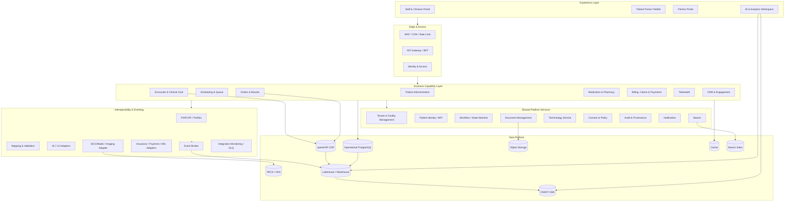
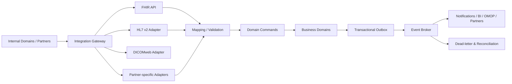
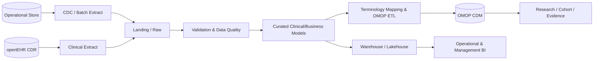

# Kiến trúc tham chiếu nền tảng quản lý phòng khám đa tenant

**Phiên bản:** 2.0  
**Ngày cập nhật:** 03/11/2026  
**Trạng thái:** Proposed Target Architecture  
**Đối tượng đọc:** CTO, Solution Architect, Engineering Lead, Clinical Informatics, Security, Data/AI  

---

## 1. Tóm tắt điều hành

Tài liệu đề xuất kiến trúc mục tiêu cho một **Clinic Management Platform đa tenant**, có khả năng phát triển từ giai đoạn triển khai ban đầu đến quy mô khoảng 1.000 phòng khám mà không phải thiết kế lại toàn bộ nền tảng.

Kiến trúc khắc phục các hạn chế của mô hình trước bằng cách:

1. Tách rõ **Experience**, **Business Capabilities**, **Shared Platform Services**, **Interoperability**, **Data Platform** và **Platform Engineering**.
2. Phân định vai trò của **PostgreSQL**, **openEHR**, **HL7 FHIR**, **DICOM/DICOMweb** và **OMOP CDM**.
3. Đưa **Tenant Management, Identity, Consent, Audit, Workflow, Eventing và Observability** thành năng lực nền tảng ngay từ đầu.
4. Tách ba mặt phẳng dữ liệu:
   - **Operational Plane** cho vận hành giao dịch.
   - **Clinical Plane** cho hồ sơ lâm sàng dài hạn.
   - **Analytical Plane** cho BI, nghiên cứu và AI.
5. Khuyến nghị triển khai ban đầu theo **Modular Monolith + Event-driven Integration**, sau đó chỉ tách microservice khi có căn cứ rõ về tải, ownership hoặc nhu cầu triển khai độc lập.

### Quyết định kiến trúc cốt lõi

- **PostgreSQL** là hệ quản trị dữ liệu giao dịch chính cho tenant, facility, scheduling, queue, billing, inventory và workflow state.
- **openEHR CDR** là canonical store cho hồ sơ lâm sàng có cấu trúc và cần tồn tại dài hạn.
- **FHIR API** là hợp đồng interoperability, không mặc định là schema lưu trữ nội bộ duy nhất.
- **DICOM/DICOMweb** phục vụ ảnh y khoa; binary imaging không được lưu như bản ghi PostgreSQL thông thường.
- **OMOP CDM** là analytical/research model được tạo qua pipeline ETL/ELT, không phải transaction store.
- Mỗi domain phải có **data ownership** rõ ràng; không cho phép các module tùy ý ghi trực tiếp vào schema của nhau.
- Mọi thao tác nhạy cảm phải gắn với `tenant`, `facility`, `actor`, `purpose`, `authorization decision` và `audit event`.

---

## 2. Mục tiêu và phạm vi

### 2.1. Mục tiêu

- Cung cấp nền tảng dùng chung cho nhiều phòng khám và nhiều cơ sở.
- Hỗ trợ cấu hình khác nhau theo tenant mà không fork mã nguồn.
- Đảm bảo cô lập dữ liệu tenant, truy vết và kiểm soát truy cập.
- Hỗ trợ hồ sơ lâm sàng có cấu trúc, versioning và semantic governance.
- Tích hợp được LIS, PACS, bảo hiểm, thanh toán, ePrescription và các đối tác bên ngoài.
- Cung cấp dữ liệu phù hợp cho vận hành, BI, nghiên cứu và AI.
- Cho phép mở rộng theo từng giai đoạn, tránh “microservices-first”.

### 2.2. Ngoài phạm vi của phiên bản này

- Thiết kế chi tiết từng specialty template.
- Lựa chọn nhà cung cấp cloud cụ thể.
- Thiết kế chi tiết claim theo từng cơ chế bảo hiểm quốc gia.
- Chứng nhận pháp lý hoặc kết luận tuân thủ. Việc tuân thủ phải được thẩm định theo phạm vi triển khai, quốc gia và loại dữ liệu thực tế.

---

## 3. Nguyên tắc kiến trúc

### 3.1. Domain-aligned

Ranh giới hệ thống phải bám theo business capability và ownership, không chia service chỉ theo bảng dữ liệu hoặc màn hình.

### 3.2. API-first, event-enabled

- API dùng cho truy vấn đồng bộ và command cần phản hồi ngay.
- Domain event dùng cho tác vụ hậu xử lý, tích hợp, notification, analytics và đồng bộ eventual consistency.
- Không sử dụng event để che giấu business transaction chưa được thiết kế rõ.

### 3.3. Canonical source rõ ràng

Mỗi loại dữ liệu phải có một hệ thống ghi nhận chính:

- Tenant/facility/practitioner configuration: Operational Platform.
- Appointment/queue/billing/inventory: domain operational store.
- Longitudinal clinical record: Clinical Data Repository.
- Imaging payload: PACS/VNA hoặc object storage phù hợp DICOM.
- Research-ready observational data: OMOP CDM.

### 3.4. Security and privacy by design

Authorization không chỉ dựa vào role. Quyết định truy cập nên xét:

`Actor + Tenant + Facility + Role + Care Relationship + Consent + Purpose + Resource + Context`

### 3.5. Standards at the boundaries

FHIR, DICOMweb và các chuẩn tích hợp được áp dụng tại boundary phù hợp. Không ép toàn bộ domain model nội bộ trở thành bản sao của external standard.

### 3.6. Build for operability

Một capability chỉ hoàn thành khi có logging, metrics, tracing, audit, backup/restore, runbook và ownership.

---

## 4. Kiến trúc logic mục tiêu



> Sơ đồ là logical architecture. Các box không đồng nghĩa mỗi box phải là một deployable microservice.

---

## 5. Phân rã theo lớp

## 5.1. Experience Layer

### Kênh chính

- **Staff & Clinician Portal:** tiếp nhận, khám, chỉ định, kê đơn, thanh toán, quản trị.
- **Patient Portal/Mobile:** đặt lịch, form số, kết quả được phép công bố, thanh toán, tư vấn từ xa.
- **Partner Portal:** kết nối đối tác, đối soát, quản lý API credential và integration status.
- **BI & Analytics Workspace:** dashboard vận hành, chất lượng, tài chính và nghiên cứu.

### Quy tắc

- Không đặt business rule quan trọng chỉ ở client.
- Sử dụng BFF khi workflow và payload khác biệt lớn giữa staff, patient và partner.
- Mọi request phải truyền tenant context theo cơ chế được xác thực; không tin `tenant_id` do client tự khai báo.

## 5.2. Edge & Access Layer

Bao gồm:

- WAF, TLS termination và rate limiting.
- API Gateway.
- Authentication federation.
- Token validation.
- Request correlation.
- API versioning và quota.
- BFF nếu cần tối ưu theo từng experience.

API Gateway không chứa clinical business rules. Gateway chỉ thực hiện policy ở boundary như authentication, routing, quota, transformation kỹ thuật tối thiểu và observability.

## 5.3. Business Capability Layer

### A. Patient Administration

- Patient registration.
- Demographics và contact points.
- Identifier lifecycle.
- Coverage/payer reference.
- Duplicate detection và merge workflow.

### B. Scheduling & Queue

- Practitioner/facility/service availability.
- Schedule, slot, appointment.
- Check-in và queue token.
- Reschedule, cancellation, no-show.
- Resource constraints: phòng, thiết bị, nhân sự.

### C. Encounter & Clinical Care

- Encounter lifecycle.
- Chief complaint, history, examination.
- Diagnosis/problem list.
- Clinical note và care plan.
- Clinical forms dựa trên template.
- Clinical sign-off/amendment.

### D. Orders & Results

- Service request/order.
- Specimen và collection workflow.
- Laboratory result.
- Imaging order và report.
- Result verification và release.
- Abnormal/critical result notification.

### E. Medication & Pharmacy

- Medication request/prescription.
- Dispense.
- Administration nếu phạm vi triển khai yêu cầu.
- Formulary.
- Inventory, batch, expiry.
- Interaction/allergy checks theo nguồn tri thức được phê duyệt.

### F. Billing, Claims & Payments

- Charge capture.
- Invoice.
- Payment/refund.
- Coverage eligibility.
- Claim submission và reconciliation.
- Tenant-specific price list.

### G. Telehealth

- Virtual encounter.
- Session orchestration.
- Consent capture.
- Tài liệu và dữ liệu phát sinh được ghi về encounter tương ứng.

### H. CRM & Engagement

- Reminder.
- Campaign có kiểm soát consent.
- Patient feedback.
- Follow-up task.
- Không sao chép tùy tiện toàn bộ clinical record sang CRM.

---

## 6. Shared Platform Services

## 6.1. Tenant & Facility Management

Đây là capability bắt buộc cho SaaS nhiều phòng khám:

- Tenant provisioning và lifecycle.
- Organization, facility, department, room.
- Practitioner và practitioner role theo facility.
- Subscription, entitlement và feature flags.
- Branding, locale, timezone, working hours.
- Tenant-level retention và configuration.
- Data migration/export khi offboarding.

## 6.2. Patient Identity / MPI

- Quản lý nhiều identifier trên cùng một bệnh nhân.
- Duplicate candidate detection.
- Human-reviewed merge/unmerge.
- Cross-tenant linkage chỉ được thực hiện khi có cơ sở nghiệp vụ, pháp lý và consent phù hợp.
- Không sử dụng email hoặc số điện thoại như primary key bất biến.

## 6.3. Workflow Service

Phù hợp với các quy trình dài:

- Appointment → Check-in → Queue → Encounter.
- Order → Collection → Processing → Verification → Release.
- Prescription → Dispense → Reconciliation.
- Claim → Submit → Reject/Approve → Reconcile.

Workflow state phải có idempotency, timeout, retry, compensation và audit. Không đặt orchestration dài hạn trong browser session.

## 6.4. Document Management

- Metadata và document lifecycle.
- Object storage cho PDF, scan và attachment.
- Versioning.
- Digital signature nếu áp dụng.
- Malware scanning.
- Retention và legal hold theo policy.
- Pre-signed access ngắn hạn hoặc streaming qua authorized service.

## 6.5. Terminology Service

- CodeSystem, ValueSet và ConceptMap.
- Versioning và effective period.
- Mapping local codes với chuẩn được lựa chọn.
- Validation tại thời điểm nhập và tích hợp.
- Không hard-code danh mục y khoa phân tán trong từng application.

## 6.6. Consent, Policy và Authorization

- Consent record và version.
- Purpose of use.
- Policy decision/permission evaluation.
- Break-glass có lý do, thời hạn và audit riêng.
- Patient-facing sharing preference nếu phạm vi sản phẩm hỗ trợ.

## 6.7. Audit & Provenance

Audit cần ghi nhận tối thiểu:

- Ai thực hiện.
- Thuộc tenant/facility nào.
- Hành động gì.
- Trên resource nào.
- Thời điểm và correlation ID.
- Kết quả authorization.
- Lý do/purpose nếu cần.
- Before/after hoặc version reference với thay đổi quan trọng.

Audit log không được sử dụng thay thế application log, và application log không được xem là audit trail.

---

## 7. Interoperability Architecture



### 7.1. FHIR

FHIR được dùng cho:

- External/inter-system API.
- Standardized healthcare resources.
- Profiles và implementation guides.
- Patient, Practitioner, Organization, Location, Appointment, Encounter, Observation, DiagnosticReport, MedicationRequest, Consent, Provenance, AuditEvent và các resource phù hợp phạm vi.

FHIR không mặc định là:

- Internal database schema cho mọi module.
- Workflow engine.
- Event broker.
- Thay thế cho clinical model governance.

### 7.2. openEHR ↔ FHIR

- openEHR template/archetype là mô hình lưu trữ lâm sàng canonical.
- FHIR profile là hợp đồng trao đổi.
- Mapping phải được quản trị theo version, test và traceability.
- Không giả định mapping một-một cho mọi clinical concept.
- Mapping failure phải đi vào monitoring/reconciliation, không âm thầm bỏ dữ liệu.

### 7.3. HL7 v2

Duy trì adapter riêng khi tích hợp LIS hoặc hệ thống legacy sử dụng message HL7 v2. Adapter chịu trách nhiệm parse, validate, acknowledge và chuyển thành command/event nội bộ. Business service không xử lý raw HL7 message trực tiếp.

### 7.4. DICOM/DICOMweb

- PACS/VNA quản lý imaging objects.
- DICOMweb cung cấp web-based query/retrieve/store phù hợp.
- Clinical domain lưu reference, report, accession/study metadata cần thiết thay vì sao chép toàn bộ binary image.
- ImagingStudy có thể liên kết clinical context với imaging endpoint.

### 7.5. Integration reliability

Bắt buộc có:

- Idempotency key.
- Correlation/causation ID.
- Retry có backoff.
- Dead-letter queue.
- Replay có kiểm soát.
- Reconciliation dashboard.
- Contract test.
- Schema/version compatibility policy.

---

## 8. Kiến trúc dữ liệu

## 8.1. Operational Plane

### Thành phần

- PostgreSQL.
- Redis hoặc distributed cache tương đương.
- Search index.
- Object storage cho tài liệu không phải DICOM.

### Dữ liệu phù hợp

- Tenant/facility configuration.
- Scheduling/queue.
- Billing/payment.
- Inventory.
- Workflow state.
- Integration state.
- Notification state.

### Chiến lược multi-tenancy

Khuyến nghị tiến hóa theo ba mức:

1. **Shared database, shared schema, tenant discriminator** ở giai đoạn đầu.
2. **Shared database, schema/domain isolation hoặc partitioning** khi cần tối ưu ownership/tải.
3. **Dedicated database/cell cho tenant đặc biệt** khi có yêu cầu quy mô, isolation hoặc hợp đồng.

Các nguyên tắc bắt buộc:

- Tenant context được resolve từ authenticated identity hoặc trusted routing.
- Row-level policy có thể dùng như defense-in-depth, không thay thế kiểm tra authorization ở service.
- Unique constraint và index phải bao gồm tenant scope khi nghiệp vụ yêu cầu.
- Background job luôn mang tenant context.
- Backup/restore phải xem xét khả năng phục hồi theo tenant.

## 8.2. Clinical Plane

### openEHR CDR

Dùng cho:

- Compositions.
- Versioned clinical content.
- Archetype/template-constrained data.
- Longitudinal record.
- AQL-based clinical query khi phù hợp.

### Clinical model governance

Mỗi template cần:

- Owner lâm sàng.
- Owner kỹ thuật.
- Version.
- Status: draft/review/approved/retired.
- Effective date.
- Compatibility/migration note.
- Mapping sang FHIR/terminology nếu có.
- Bộ dữ liệu test đại diện.

Không cho phép application tự tạo cấu trúc clinical JSON tùy ý ngoài governance process.

## 8.3. Analytical Plane

### Thành phần

- Landing/bronze zone.
- Curated/silver zone.
- Business/clinical gold models.
- Warehouse/lakehouse.
- OMOP CDM.
- BI semantic model.
- De-identification/pseudonymization pipeline.

### OMOP CDM

OMOP dùng cho:

- Chuẩn hóa observational data.
- Cohort definition.
- Population-level analysis.
- Patient-level prediction và research tooling khi được quản trị phù hợp.

OMOP không dùng làm nguồn giao dịch cho encounter đang diễn ra. Dữ liệu được nạp từ operational/clinical sources qua pipeline có kiểm soát, kèm lineage và data-quality checks.

### Luồng dữ liệu



---

## 9. Data ownership và source of truth

| Data domain | System of record đề xuất | Consumer chính | Ghi chú |
|---|---|---|---|
| Tenant, facility, entitlement | Tenant Platform | Tất cả domain | Không để từng module tự quản tenant riêng |
| Patient demographic/identifier | Patient Administration/MPI | Clinical, billing, portal | Clinical snapshot có thể được ghi cùng encounter nhưng master lifecycle thuộc MPI/PAS |
| Schedule/appointment/queue | Scheduling domain | Portal, encounter, CRM | Phân biệt schedule availability và appointment state |
| Encounter workflow | Encounter domain | Clinical, billing, analytics | Clinical content chi tiết lưu tại CDR |
| Longitudinal clinical content | openEHR CDR | Clinician app, FHIR, analytics | Template/archetype governed |
| Order/result state | Orders & Results | Encounter, portal, billing | Result clinical payload có thể lưu CDR |
| Imaging object | PACS/VNA | Viewer, imaging workflow | Clinical system giữ reference/metadata cần thiết |
| Prescription/dispense | Medication/Pharmacy | Clinical, inventory, billing | Tách request, dispense và stock movement |
| Invoice/payment/claim | Finance domain | Portal, accounting, BI | Không ghi clinical detail thừa vào payment provider |
| Documents/attachments | Object storage + metadata service | Các domain được cấp quyền | Có retention, checksum, malware scan |
| Research-ready data | OMOP CDM | Research/analytics | Derived, không phải source of truth |

---

## 10. Security Architecture

## 10.1. Identity domains

- Workforce identity.
- Patient identity.
- Service/workload identity.
- Partner/API client identity.

Không dùng cùng một authentication flow cho tất cả actor types.

## 10.2. Authorization

Kết hợp:

- RBAC cho quyền cơ bản theo vai trò.
- ABAC cho tenant, facility, specialty, care relationship, resource sensitivity và context.
- Policy enforcement tại API/service boundary.
- Database control là lớp phòng vệ bổ sung.

## 10.3. Secrets và key management

- Không lưu secrets trong source code hoặc tenant configuration dạng plaintext.
- Sử dụng managed secret store/KMS tương ứng nền tảng triển khai.
- Rotation và revocation phải có runbook.
- Tách key/credential theo environment và integration boundary.

## 10.4. Data protection

- TLS cho data in transit.
- Encryption at rest.
- Field/token protection bổ sung cho dữ liệu đặc biệt nhạy cảm nếu threat model yêu cầu.
- Masking trong non-production.
- Không dùng dữ liệu production nguyên trạng cho test mặc định.
- Export/download phải được authorization và audit.

## 10.5. Security events cần giám sát

- Đăng nhập thất bại bất thường.
- Truy cập hàng loạt hồ sơ bệnh nhân.
- Break-glass access.
- Export lớn.
- Thay đổi role/policy.
- Integration credential failure.
- Cross-tenant access denial.
- Audit pipeline interruption.

---

## 11. Event-driven Architecture

### Event mẫu

- `TenantProvisioned`
- `PatientRegistered`
- `AppointmentBooked`
- `PatientCheckedIn`
- `EncounterStarted`
- `EncounterCompleted`
- `OrderPlaced`
- `ResultFinalized`
- `PrescriptionIssued`
- `MedicationDispensed`
- `InvoiceIssued`
- `PaymentCompleted`

### Quy tắc thiết kế event

- Event diễn tả sự kiện đã xảy ra, không phải RPC trá hình.
- Không đưa toàn bộ hồ sơ lâm sàng vào event nếu consumer chỉ cần identifier và status.
- Schema phải versioned.
- PII/clinical payload phải được tối thiểu hóa.
- Producer dùng transactional outbox khi cần bảo đảm DB commit và event publication không lệch nhau.
- Consumer phải idempotent.

---

## 12. Deployment Architecture

## 12.1. Khuyến nghị giai đoạn đầu

**Modular Monolith** cho phần lớn transaction domains, kết hợp:

- Module boundary rõ.
- Schema ownership rõ.
- Internal application contracts.
- Transactional outbox.
- Event broker.
- openEHR CDR triển khai như platform component riêng.
- FHIR/integration gateway triển khai riêng nếu vòng đời và tải tích hợp khác biệt.
- Analytics pipeline tách khỏi transaction workload.

### Vì sao không microservices-first

- Giảm distributed transaction và operational overhead.
- Dễ giữ consistency cho workflow phòng khám ban đầu.
- Cho phép xác nhận bounded context trước khi tách deployable.
- Vẫn giữ đường tiến hóa nhờ module boundary và event contract.

## 12.2. Khi nào nên tách service

Tách khi có ít nhất một động lực rõ:

- Team ownership độc lập.
- Tải hoặc scaling profile khác biệt.
- Security/isolation boundary riêng.
- Release frequency khác biệt.
- Failure isolation cần thiết.
- Công nghệ hoặc integration runtime đặc thù.

Ứng viên thường được tách sớm hơn:

- Notifications.
- Document processing.
- Integration adapters.
- Imaging gateway.
- Analytics ingestion.
- Search indexing.
- Identity/tenant platform nếu phục vụ nhiều sản phẩm.

## 12.3. Cell-based evolution

Khi quy mô tăng, có thể nhóm tenant vào các deployment cell:

- Mỗi cell có application workload và operational database partition/cluster riêng.
- Control plane quản lý tenant placement, entitlement và routing.
- Clinical/analytics components có thể cell-scoped hoặc regional tùy yêu cầu.
- Giảm blast radius và cho phép mở rộng tuyến tính hơn so với một cụm toàn cục duy nhất.

---

## 13. Observability và Platform Engineering

### Bắt buộc

- Structured application logs.
- Distributed tracing.
- Metrics.
- Audit pipeline.
- Error tracking.
- SLO dashboard.
- Dependency health.
- Integration queue depth và DLQ.
- Database saturation/replication/backup monitoring.

### Correlation

Một request/transaction nên truy vết được qua:

`request_id → user/session → tenant/facility → domain transaction → outbox event → integration message → analytical ingestion`

Không ghi clinical payload đầy đủ vào log chỉ để hỗ trợ debug.

### Resilience

- Timeouts bắt buộc cho remote calls.
- Retry chỉ áp dụng cho lỗi tạm thời và operation idempotent.
- Circuit breaker cho external dependencies.
- Bulkhead cho integration quan trọng.
- Graceful degradation cho notification/analytics khi transaction chính vẫn có thể tiếp tục an toàn.

---

## 14. Non-functional Requirements đề xuất

Các con số chính thức phải được chốt bằng workload model và SLA hợp đồng. Bộ tiêu chí dưới đây là khung để thiết kế và kiểm thử:

### Availability và recovery

- Phân loại tier cho từng capability.
- Xác định RTO/RPO riêng cho operational DB, CDR, object storage, PACS và analytics.
- Kiểm thử restore định kỳ, không chỉ kiểm tra backup job thành công.
- Có runbook cho mất integration, mất broker, CDR chậm và external provider outage.

### Performance

- Đặt latency budget theo user journey thay vì chỉ theo từng API.
- Tách reporting query khỏi OLTP workload.
- Dùng cache cho reference/configuration data có chiến lược invalidation.
- Kiểm thử hot tenant, không chỉ tải phân bố đều.

### Scalability

- Horizontal scaling cho stateless application nodes.
- Partition/index strategy cho các bảng lớn theo tenant/time khi cần.
- Asynchronous processing cho document, notification, export và analytics.
- Backpressure cho integration consumer.

### Maintainability

- Architecture Decision Records.
- Contract tests.
- Database migration automation.
- Feature flags có expiry/owner.
- Dependency và vulnerability management.

---

## 15. Governance Model

## 15.1. Architecture governance

- Architecture Decision Record cho quyết định quan trọng.
- Review boundary/data ownership trước khi tạo service mới.
- API lifecycle và deprecation policy.
- Event schema registry và compatibility rules.

## 15.2. Clinical model governance

- Clinical modelling board.
- Archetype/template review.
- Terminology binding review.
- Safety review cho form, rules và alerts.
- Version/migration policy.

## 15.3. Data governance

- Data owner và steward theo domain.
- Data classification.
- Lineage.
- Retention/deletion.
- Data-quality rules.
- Access review.
- De-identification policy cho analytical/research use.

## 15.4. AI governance

Phân loại use case:

- Administrative AI: no-show, scheduling, document classification.
- Clinical support AI: summarization, risk signal, decision support.
- Research AI: cohort/prediction trên OMOP hoặc curated datasets.

Clinical AI phải có kiểm soát riêng về dữ liệu đầu vào, intended use, human oversight, model/version traceability, monitoring và rollback. Không cho phép mô hình AI ghi trực tiếp kết luận lâm sàng đã ký mà không qua workflow phù hợp.

---

## 16. Lộ trình triển khai

## Giai đoạn 0: Foundation

- Tenant/facility model.
- Identity và authorization baseline.
- PostgreSQL operational foundation.
- Audit, logging, tracing.
- CI/CD, IaC và secrets management.
- API conventions và ADR process.

## Giai đoạn 1: Core Clinic Operations

- Patient Administration/MPI cơ bản.
- Scheduling, online booking, check-in và queue.
- Encounter shell.
- Billing/payment cơ bản.
- Notification.
- Modular monolith boundary và outbox.

## Giai đoạn 2: Clinical Platform

- openEHR CDR.
- Archetype/template governance.
- Clinical charting.
- Orders/results.
- Medication/ePrescription.
- Document management.
- Terminology service.

## Giai đoạn 3: Interoperability

- FHIR API và profiles ưu tiên.
- LIS adapter.
- DICOMweb/PACS integration.
- Insurance/payment/ePrescription adapters.
- Integration monitoring, DLQ và reconciliation.

## Giai đoạn 4: Analytics & OMOP

- Lakehouse/warehouse ingestion.
- Curated operational/clinical models.
- OMOP ETL và standardized vocabularies.
- Data-quality dashboard và lineage.
- De-identified research datasets.

## Giai đoạn 5: Scale-out

- Hot-tenant control.
- Cell-based deployment nếu có căn cứ.
- Tách các service có scaling/ownership khác biệt.
- DR testing nâng cao.
- Capacity model và cost governance.

---

## 17. Rủi ro kiến trúc và biện pháp giảm thiểu

| Rủi ro | Tác động | Biện pháp |
|---|---|---|
| Shared database coupling | Module không thể thay đổi độc lập | Schema ownership, repository/API boundary, migration review |
| FHIR bị dùng làm internal model cho mọi thứ | Domain model phức tạp và phụ thuộc chuẩn bên ngoài | Dùng FHIR tại interoperability boundary, mapping có governance |
| openEHR template phát triển không kiểm soát | Semantic fragmentation | Clinical modelling board, versioning, test data, review gate |
| OMOP được dùng cho giao dịch real-time | Write model không phù hợp | Chỉ nạp OMOP qua analytical pipeline |
| Cross-tenant data leak | Sự cố nghiêm trọng | Trusted tenant context, policy enforcement, tests, audit, defense in depth |
| Integration monolith | Thay đổi một đối tác ảnh hưởng toàn bộ | Adapter isolation, canonical command/event, contract tests |
| Event duplication/out-of-order | Trạng thái consumer sai | Idempotency, sequencing strategy, reconciliation |
| Analytics gây tải OLTP | Chậm giao dịch khám | CDC/batch ingestion, read model, warehouse/lakehouse |
| PHI xuất hiện trong log | Rò rỉ dữ liệu | Log minimization, redaction, access control, retention |
| Microservices quá sớm | Tăng độ phức tạp vận hành | Modular monolith trước, tách theo measurable drivers |
| AI thiếu traceability | Không kiểm soát được kết quả | Model/version registry, input/output audit, human review |

---

## 18. Kiểm tra nhất quán kiến trúc

Trước khi phê duyệt một module hoặc integration mới, kiểm tra:

1. Capability thuộc bounded context nào?
2. Ai sở hữu dữ liệu?
3. System of record là gì?
4. Dữ liệu là operational, clinical hay analytical?
5. API đồng bộ hay event bất đồng bộ phù hợp hơn?
6. Tenant/facility context được xác thực ở đâu?
7. Authorization và consent được đánh giá ở đâu?
8. Có audit và provenance không?
9. Có chứa tài liệu/ảnh lớn cần object storage hoặc PACS không?
10. Có mapping FHIR/openEHR/terminology cần versioning không?
11. Failure mode, retry, idempotency và reconciliation là gì?
12. Monitoring, SLO, backup và restore đã được thiết kế chưa?

---

## 19. Decision Summary cho CTO/SA Review

### Chấp thuận đề xuất

- Kiến trúc nhiều lớp, domain-aligned.
- PostgreSQL làm operational store.
- openEHR CDR làm canonical clinical store.
- FHIR làm interoperability contract.
- DICOM/DICOMweb cho imaging integration.
- OMOP CDM ở analytical plane.
- Modular Monolith trước, microservices theo nhu cầu thực tế.
- Event broker + transactional outbox cho integration và downstream processing.
- Tenant, IAM, consent, audit và observability là platform capabilities.

### Cần quyết định tiếp

- Phạm vi clinical record đưa vào openEHR ngay từ giai đoạn nào.
- Chọn openEHR CDR product/implementation.
- FHIR baseline/version và implementation guides áp dụng.
- Cơ chế tenant isolation mặc định và tiêu chí dedicated tenant/cell.
- Cloud/provider và managed services.
- RTO/RPO theo từng capability.
- Terminology set và licensing phù hợp thị trường triển khai.
- PACS/VNA strategy: build, buy hay integrate.
- Data residency và retention theo khu vực hoạt động.

---

## 20. Tài liệu tham khảo

1. openEHR Foundation, **What is openEHR?**: https://openehr.org/what-is-openehr/
2. openEHR, **Architecture Overview**: https://specifications.openehr.org/releases/BASE/latest/architecture_overview.html
3. HL7, **FHIR Overview for Architects, R5**: https://www.hl7.org/fhir/overview-arch.html
4. HL7, **FHIR R5 Specification Index**: https://fhir.hl7.org/fhir/index.html
5. OHDSI, **OMOP Common Data Model**: https://ohdsi.github.io/CommonDataModel/
6. DICOM Standards Committee, **DICOMweb**: https://www.dicomstandard.org/using/dicomweb
7. DICOM Standards Committee, **DICOMweb and HL7 FHIR**: https://www.dicomstandard.org/using/dicomweb/dicomweb-and-hl7-fhir

---

## Phụ lục A. Thuật ngữ chuẩn hóa

| Thuật ngữ | Ý nghĩa trong kiến trúc |
|---|---|
| Operational Data | Dữ liệu vận hành/giao dịch của scheduling, billing, queue, inventory, configuration |
| Clinical Data | Dữ liệu sức khỏe và chăm sóc bệnh nhân có ý nghĩa lâm sàng |
| openEHR CDR | Kho dữ liệu lâm sàng dựa trên openEHR, archetype và template |
| FHIR API | API trao đổi dữ liệu y tế dựa trên FHIR resources/profiles |
| OMOP CDM | Common Data Model cho observational analytics và research |
| Terminology Service | Dịch vụ quản lý code systems, value sets, mappings và validation |
| MPI | Master Patient Index/Patient Identity capability |
| PACS/VNA | Nền tảng lưu trữ và truy xuất ảnh y khoa |
| DICOMweb | Các dịch vụ web RESTful cho DICOM imaging |
| System of Record | Nguồn ghi nhận chính thức cho một data domain |
| Bounded Context | Ranh giới ngữ nghĩa và ownership trong domain design |
| Control Plane | Quản lý tenant placement, entitlement, policy và cấu hình nền tảng |
| Data Plane | Workload xử lý dữ liệu nghiệp vụ/clinical của tenant |

## Phụ lục B. Cấu trúc repository tham khảo

```text
/platform
  /tenant-management
  /identity-policy
  /audit
  /notifications
/domains
  /patient-administration
  /scheduling-queue
  /encounter
  /orders-results
  /medication-pharmacy
  /billing-claims-payments
/integration
  /fhir
  /hl7v2
  /dicomweb
  /partner-adapters
  /event-contracts
/clinical-models
  /archetypes
  /templates
  /terminology-bindings
  /mappings
/data-platform
  /operational-migrations
  /pipelines
  /omop-etl
  /data-quality
/platform-engineering
  /infrastructure-as-code
  /observability
  /runbooks
/docs
  /adr
  /architecture
  /security
```
